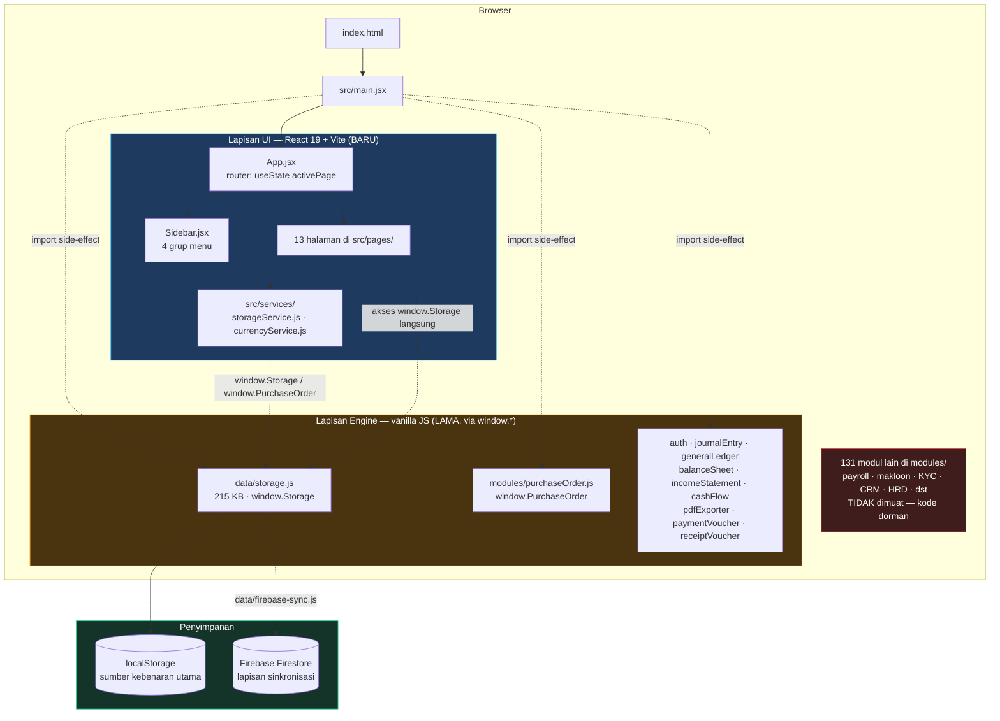
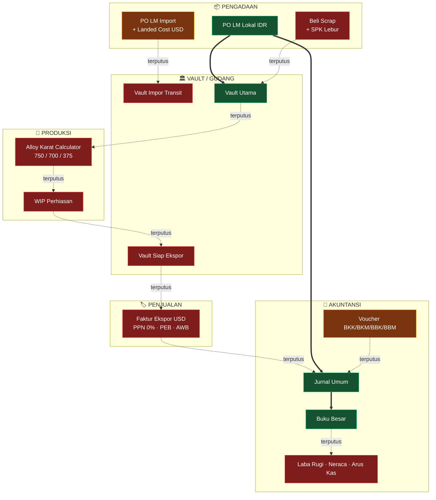
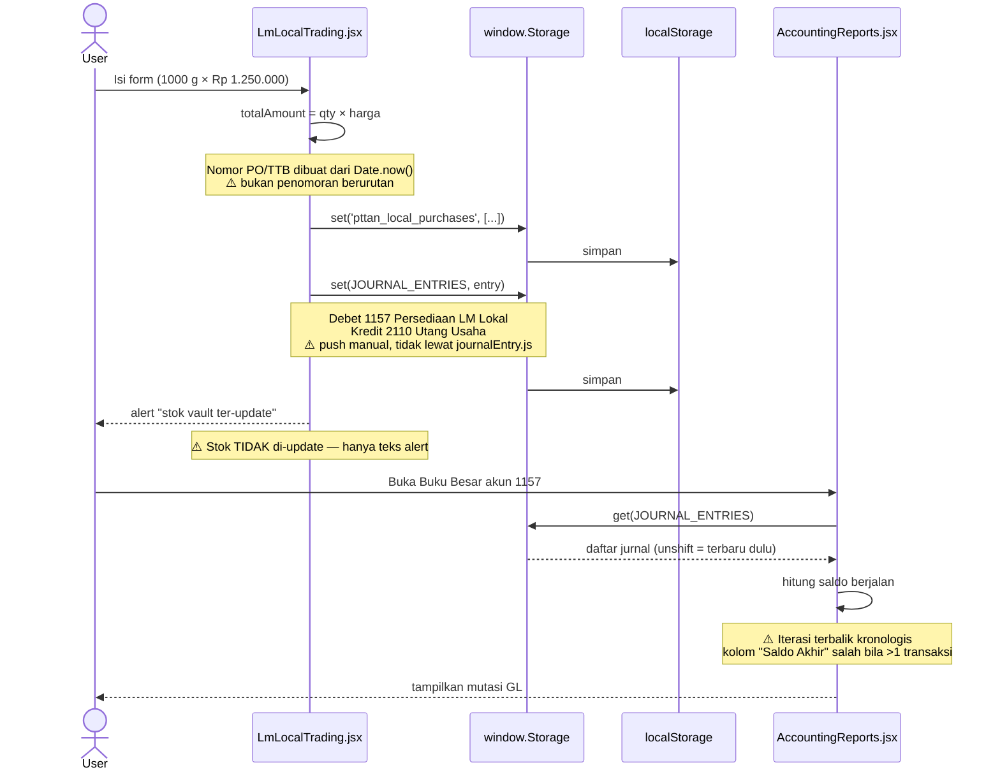

# Analisis Flow ERP — PT TAN (branch `tan_pfelix`)

> Dibuat: 2026-08-10 · Basis: commit `d0611d9` · Cakupan: aplikasi React di `src/` (UI aktif) + engine legacy di `modules/` & `data/`

---

## 1. Arsitektur: dua aplikasi dalam satu repo

`index.html` hanya memuat `/src/main.jsx`. Aplikasi vanilla lama (`app.js`, 145 file `modules/`) **tidak lagi jadi entry point** — tapi 14 modulnya di-import sebagai side-effect oleh `main.jsx` dan menempel ke `window`.

**Catatan penting:**
- `login.html` masih memakai jalur lama (`<script src="data/storage.js">`) dan **tidak terhubung** ke aplikasi React. Praktisnya app React terbuka tanpa autentikasi.
- Dua halaman (`LmLocalTrading`, `VoucherManagement`, `AccountingReports`) memanggil `window.Storage` **langsung**, melewati `storageService.js`. Lapisan service jadi tidak konsisten.

---

## 2. Flow bisnis yang dirancang vs. yang benar-benar jalan

Rantai bisnisnya: **Pengadaan → Vault → Produksi → Ekspor → Akuntansi**.

Legenda: 🟩 hijau = tersimpan & mengalir · 🟧 oranye = tersimpan tapi tidak mengalir ke hilir · 🟥 merah = UI saja, tidak ada persistensi. Garis putus = mata rantai yang belum tersambung.

---

## 3. Status per halaman

| Halaman | Simpan data? | Ke mana | Jurnal otomatis? | Update stok? | Status |
|---|---|---|---|---|---|
| `LmImportTrading` | ✅ | `PURCHASE_ORDERS` via `PurchaseOrder.createOrder` | ❌ | ❌ | 🟧 Parsial |
| `LmLocalTrading` | ✅ | `pttan_local_purchases` + `JOURNAL_ENTRIES` | ✅ 1157/2110 | ❌ (hanya label) | 🟩 Jalan |
| `BuyingScrapMelting` | ❌ | — | ❌ | ❌ | 🟥 Kalkulator |
| `JewelryProduction` | ❌ | — | ❌ | ❌ | 🟥 Kalkulator |
| `ExportInvoicing` | ❌ | — | ❌ | ❌ | 🟥 Kalkulator |
| `WarehouseManagement` | ❌ | array hardcoded di `useState` | — | — | 🟥 Mockup |
| `VoucherManagement` | ✅ | `PAYMENT_VOUCHERS` / `RECEIPT_VOUCHERS` | ❌ (label bohong) | — | 🟧 Parsial |
| `AccountingReports` | ✅ | `JOURNAL_ENTRIES` | manual | — | 🟧 Parsial |
| `Dashboard` | ❌ | angka hardcoded | — | — | 🟥 Mockup |
| Master Item/Customer/Supplier | ✅ | via `storageService` | — | — | 🟩 Jalan |
| `ChartOfAccounts` | ✅ | `CHART_OF_ACCOUNTS` | — | — | 🟩 Jalan |

---

## 4. Satu-satunya jalur end-to-end yang benar-benar hidup

Hanya **Pembelian LM Lokal → Jurnal → Buku Besar**.

---

## 5. Temuan utama

### Blocker fungsional

1. **Rantai persediaan tidak pernah tersambung.** Tidak ada satu pun halaman yang menulis ke `warehouseStock` / kartu stok. `WarehouseManagement.jsx:6-16` memakai array hardcoded di `useState`, jadi angka vault statis selamanya. Alert di `LmLocalTrading.jsx:75` mengklaim "Stok Vault Ter-update" padahal tidak ada kode yang melakukannya.

2. **Tiga halaman transaksi tanpa handler.** Tombol di `BuyingScrapMelting.jsx:79`, `JewelryProduction.jsx:64`, dan `ExportInvoicing.jsx:98` tidak punya `onClick` sama sekali. Klik = tidak terjadi apa-apa. Artinya: scrap, produksi, dan penjualan ekspor belum ada datanya.

3. **PO Impor tidak pernah masuk buku.** `createPurchaseOrder` menghitung `unitLandedCostIDRPerGram` dengan benar dan menyimpan PO berstatus `'draft'`, tapi tidak ada jurnal Debet 1158 dan tidak ada langkah approval/penerimaan di UI React. Landed cost berhenti sebagai angka tampilan.

4. **"Auto-Jurnal" pada voucher tidak ada.** Tombol di `VoucherManagement.jsx:186` bertuliskan "Terbitkan Voucher & Auto-Jurnal", tapi `handleCreateVoucher` (baris 44-78) hanya menyimpan voucher — tidak ada penulisan ke `JOURNAL_ENTRIES`. Kas keluar tidak pernah tercermin di laporan.

5. **Laba Rugi, Neraca, dan Arus Kas adalah HTML statis.** `AccountingReports.jsx:300-398` — seluruh angka (Rp 2.35 M pendapatan, Rp 5.5 M total aset, dst.) di-hardcode di JSX, tidak dihitung dari `JOURNAL_ENTRIES`. Modul `incomeStatement.js`, `balanceSheet.js`, `cashFlow.js` sudah di-import di `main.jsx` tapi tidak pernah dipanggil.

### Bug

6. **Saldo berjalan Buku Besar salah arah.** `AccountingReports.jsx:64-80` mengiterasi `journals` apa adanya, padahal jurnal disimpan dengan `unshift` (terbaru di depan). Saldo terakumulasi dari transaksi terbaru ke terlama. Perlu sort naik berdasarkan tanggal sebelum akumulasi.

7. **Kode akun 1160 dobel di COA default.** `data/storage.js:1897` mendefinisikan 1160 sebagai detail "Persediaan Perhiasan Emas Siap Ekspor", lalu baris 1974 mendefinisikan ulang 1160 sebagai header "PERSEDIAAN BARANG DALAM PROSES (WIP)". Dropdown COA akan menampilkan duplikat dan pencarian `find(a => a.code === '1160')` ambigu.

8. **Akun 4110 tidak ada di COA.** Laporan Laba Rugi menampilkan "4110 - Pendapatan Ekspor Logam Mulia", tapi kode itu tidak terdaftar di `getDefaultChartOfAccounts()`. Kode 4120 ada, tapi sebagai header "PENDAPATAN JASA" — bukan "Pendapatan Ekspor Perhiasan" seperti di UI.

9. **Penomoran dokumen dari `Date.now()`.** PO, TTB, jurnal, dan voucher semua memakai `Date.now().toString().slice(-6)`. Tidak berurutan, bisa bentrok, dan tidak memenuhi kaidah penomoran dokumen akuntansi. Bandingkan `modules/purchaseOrder.js:130-170` yang sudah punya generator berurutan `PO-YYYYMM-0001` — logika itu tersedia tapi tidak dipakai halaman lain.

10. **Sisi debet/kredit belum dinormalisasi.** Saldo GL dihitung `debit - credit` untuk semua akun. Untuk akun kewajiban, ekuitas, dan pendapatan (2110, 3110, 4xxx) saldo akan tampil negatif.

### Catatan arsitektur

11. **PPh 22 Impor tidak dikapitalisasi ke landed cost** — ini **benar** secara akuntansi (PPh 22 adalah pajak dibayar di muka yang dapat dikreditkan, bukan biaya perolehan). Nilainya ditangkap di form dan diteruskan ke payload, jadi tinggal dijurnalkan ke akun pajak dibayar di muka saat penerimaan barang.

12. **Kalkulasi landed cost terduplikasi.** `LmImportTrading.jsx:37-40` menghitung ulang persis rumus yang sudah ada di `modules/purchaseOrder.js:240-247`. Dua sumber kebenaran untuk formula yang sama — rawan menyimpang.

13. **131 modul dorman.** Payroll, makloon, KYC, CRM, HRD, fixed assets, dan lainnya (~2 MB kode) berasal dari proyek Gold Refinery sebelumnya. Tidak dimuat, tidak dites terhadap app React, tapi masih ada di repo dan di-cover oleh `tests/`. `README.md` juga masih mendeskripsikan aplikasi lama.

14. **Tidak ada autentikasi di app React.** `modules/auth.js` dimuat, tapi `App.jsx` tidak punya route guard. `login.html` berdiri sendiri.

---

## 6. Urutan perbaikan yang disarankan

Untuk menyambungkan rantai, urutan paling efisien:

1. **Buat satu layanan posting terpusat** (mis. `src/services/journalService.js`) yang membungkus `window.JournalEntry`, dengan penomoran berurutan. Ganti semua `unshift` manual ke `JOURNAL_ENTRIES`.
2. **Buat `stockService.js`** yang menulis kartu stok, lalu sambungkan dari LM Lokal, penerimaan PO Impor, output lebur, dan pengeluaran ekspor.
3. **Hidupkan `WarehouseManagement`** dari kartu stok tersebut, bukan array hardcoded.
4. **Pasang handler** pada Scrap, Produksi, dan Faktur Ekspor.
5. **Tambahkan langkah penerimaan PO Impor** (GR/TTB) yang memicu jurnal Debet 1158 + PPh 22 dibayar di muka.
6. **Ganti tiga tab laporan statis** dengan pemanggilan `incomeStatement.js` / `balanceSheet.js` / `cashFlow.js` yang sudah tersedia.
7. **Perbaiki bug GL** (urutan tanggal + normalisasi debet/kredit) dan **bersihkan duplikat COA 1160 & akun 4110**.
