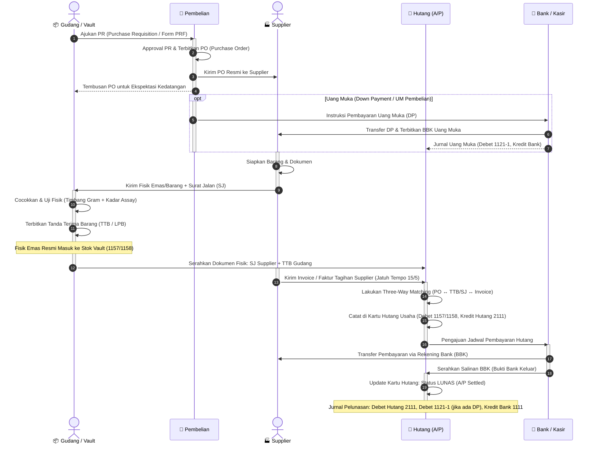

# Alur Proses Bisnis & Dokumen Pembelian (Procurement Flow)

> **Dokumentasi Flowchart, Business Process & Pemetaan Jurnal COA (SAK EMKM)**  
> Ditranskripsikan dari sketsa operasional whiteboard: alur pengadaan multi-divisi dari Permintaan Pembelian (*PR/PRF*), *Purchase Order (PO)*, Pengiriman Supplier & Penerimaan Fisik di Vault (*Surat Jalan/SJ & TTB*), Pencatatan *Kartu Hutang (A/P)*, hingga Penerbitan *Bukti Bank Keluar (BBK)* dan Pelunasan Kas/Bank.

---

## 1. Diagram Alur Swimlane (Mermaid Flowchart)

```mermaid
flowchart TD
    %% Definisi Swimlane / Subgraph Divisi
    subgraph LANE_SUPP["1. SUPPLIER (Pemasok)"]
        S_RCV_PO["Menerima PO dari PT TAN"]
        S_DP["(Opsi) Terima Uang Muka / DP"]
        S_SHIP["Kirim Fisik Barang + Surat Jalan (SJ)<br/><i>Contoh: Batch 1/5</i>"]
        S_SEND_INV["Kirim Invoice / Faktur Supplier<br/><i>Contoh: Jatuh Tempo 15/5</i>"]
        S_RCV_PAY["Terima Pelunasan Transfer Bank"]
    end

    subgraph LANE_PURCH["2. PEMBELIAN (Purchasing Dept)"]
        P_RCV_PR["Menerima PR (Purchase Requisition)<br/>dari Gudang / Produksi"]
        P_APP_PRF["Validasi & Approval Form PRF"]
        P_CREATE_PO["Menerbitkan Purchase Order (PO)"]
        P_SEND_PO["Kirim PO ke Supplier & Tembusan Gudang"]
    end

    subgraph LANE_WH["3. GUDANG & VAULT (Warehouse)"]
        W_REQ_PR["Kebutuhan Stok: Terbitkan PR"]
        W_RCV_SJ["Menerima Fisik Barang + SJ Supplier"]
        W_QC["Cocokkan + Cek Fisik:<br/>Timbang Gram, Uji Kadar (Assay)"]
        W_CREATE_TTB["Menerbitkan Tanda Terima Barang (TTB)<br/><i>(Masuk ke Stok Fisik Vault)</i>"]
        W_FORWARD_DOC["Oper Dokumen SJ + TTB ke Bagian Hutang"]
    end

    subgraph LANE_AP["4. HUTANG (A/P & Verification)"]
        AP_MATCH["Three-Way Matching:<br/>PO ↔ TTB (SJ) ↔ Invoice Supplier"]
        AP_RECORD_CARD["Catat di Kartu Hutang Usaha<br/>(Register Tagihan Jatuh Tempo)"]
        AP_SETTLE_PLAN["Pengajuan Jadwal Bayar / BBK<br/>Potong Uang Muka (UM) jika ada"]
    end

    subgraph LANE_BANK["5. BANK & KASIR (Disbursement)"]
        B_PAY_DP["(Opsi) Bayar Uang Muka (DP / UM)"]
        B_CREATE_BBK["Menerbitkan Bukti Bank Keluar (BBK)"]
        B_TRANSFER["Transfer Pembayaran ke Rekening Supplier"]
    end

    %% Hubungan dan Alur Antar-Divisi
    W_REQ_PR --> P_RCV_PR
    P_RCV_PR --> P_APP_PRF
    P_APP_PRF --> P_CREATE_PO
    P_CREATE_PO --> P_SEND_PO
    P_SEND_PO -->|1. Kirim Dokumen PO| S_RCV_PO

    %% Alur Uang Muka (Bila Supplier minta DP)
    P_CREATE_PO -.->|Jika syarat DP| B_PAY_DP
    B_PAY_DP -.->|Transfer DP via BBK| S_DP
    B_PAY_DP -.->|Catat Uang Muka Pembelian (1121-1)| AP_SETTLE_PLAN

    %% Alur Pengiriman & Penerimaan Gudang
    S_RCV_PO -->|2. Pengiriman Barang (1/5)| S_SHIP
    S_SHIP -->|Fisik + SJ| W_RCV_SJ
    W_RCV_SJ --> W_QC
    W_QC --> W_CREATE_TTB
    W_CREATE_TTB -->|3. Update Stok Vault| W_FORWARD_DOC
    W_FORWARD_DOC -->|Serahkan SJ + TTB| AP_MATCH

    %% Alur Penagihan Invoice Supplier
    S_SHIP -->|4. Kirim Tagihan (15/5)| S_SEND_INV
    S_SEND_INV --> AP_MATCH

    %% Alur Pencatatan Hutang & Pelunasan
    AP_MATCH --> AP_RECORD_CARD
    AP_RECORD_CARD --> AP_SETTLE_PLAN
    AP_SETTLE_PLAN -->|5. Otorisasi Bayar| B_CREATE_BBK
    B_CREATE_BBK --> B_TRANSFER
    B_TRANSFER -->|6. Bukti Transfer / BBK| S_RCV_PAY

    %% Styling Theme
    classDef suppClass fill:#1e293b,stroke:#94a3b8,color:#f8fafc,stroke-width:1.5px;
    classDef purchClass fill:#1e3a5f,stroke:#38bdf8,color:#f8fafc,stroke-width:1.5px;
    classDef whClass fill:#3b2d14,stroke:#f59e0b,color:#f8fafc,stroke-width:1.5px;
    classDef apClass fill:#3f1d2e,stroke:#f43f5e,color:#f8fafc,stroke-width:1.5px;
    classDef bankClass fill:#14342a,stroke:#10b981,color:#f8fafc,stroke-width:1.5px;

    class S_RCV_PO,S_DP,S_SHIP,S_SEND_INV,S_RCV_PAY suppClass;
    class P_RCV_PR,P_APP_PRF,P_CREATE_PO,P_SEND_PO purchClass;
    class W_REQ_PR,W_RCV_SJ,W_QC,W_CREATE_TTB,W_FORWARD_DOC whClass;
    class AP_MATCH,AP_RECORD_CARD,AP_SETTLE_PLAN apClass;
    class B_PAY_DP,B_CREATE_BBK,B_TRANSFER bankClass;
```

---

## 2. Sequence Diagram (Pertukaran Dokumen Antar-Fungsi)



---

## 3. Pemetaan Lengkap Debit & Credit Setiap Part di COA SAK EMKM

Berikut adalah aturan penjurnalan baku per setiap part / tahapan pengadaan barang sesuai **Chart of Accounts (COA)** yang berlaku di ERP PT TAN (`data/storage.js` & `docs/blueprint/ACCOUNTING.md`):

### PART 1: Permintaan Pembelian (PR) & Penerbitan Purchase Order (PO)
* **Dokumen Sumber**: Purchase Requisition (`PR-xxxx`) $\rightarrow$ Purchase Order (`PO-xxxx`)
* **Status Finansial**: **TIDAK ADA JURNAL (Non-Posting Transaction)**
* **Penjelasan**: PR dan PO adalah komitmen internal dan pemesanan ke pihak luar. Sebelum ada pembayaran uang muka atau serah terima fisik barang, belum terjadi perubahan nilai aset/liabilitas di buku besar.

---

### PART 2: Pembayaran Uang Muka Pembelian (Down Payment / DP)
* **Dokumen Sumber**: Bukti Bank Keluar DP (`BBK-DP-xxxx`)
* **Pemicu**: Pembelian mewajibkan uang muka sebelum supplier mengirimkan emas/barang.
* **Perlakuan Akuntansi**: Mengurangi saldo Kas/Bank dan mencatat penambahan Aset Lancar (Uang Muka Pembelian).

#### 🟢 Pembelian Emas Lokal (IDR):
| Posisi | Kode Akun | Nama Akun COA | Tipe | Penjelasan |
|---|---|---|---|---|
| **DEBET** | `1121-1` | **Uang Muka Pembelian Emas Lokal** | Detail | Aset lancar klaim hak terima barang lokal |
| **KREDIT** | `1111-IDR` | **Bank BCA IDR (Operasional & Beli Lokal)** | Detail | Kas/Bank keluar untuk pembayaran DP |
| *(atau)* | `1110` | **Kas** | Detail | Jika dibayar tunai via kasir |

#### 🟢 Pembelian Emas Impor (USD/SGD Bullion):
| Posisi | Kode Akun | Nama Akun COA | Tipe | Penjelasan |
|---|---|---|---|---|
| **DEBET** | `1121-2` | **Uang Muka Pembelian Emas Impor** | Detail | Aset lancar klaim hak emas impor (YLG, dll) |
| **KREDIT** | `1111-USD` | **Bank BCA Devisa USD** | Detail | Pembayaran devisa USD |
| *(atau)* | `1111-SGD` | **Bank BCA Devisa SGD** | Detail | Pembayaran devisa SGD |

---

### PART 3: Penerimaan Barang di Vault & Penerbitan TTB (Goods Receipt)
* **Dokumen Sumber**: Surat Jalan Supplier (`SJ`) + Tanda Terima Barang (`TTB-xxxx` / `GR-xxxx`).
* **Pemicu**: Fisik emas tiba di lokasi, diverifikasi timbangan gram, diuji kadar/assay, dan dimasukkan ke dalam brankas (Vault).
* **Perlakuan Akuntansi**:

#### 🟢 Skenario A: Pembelian Tempo / Kredit (Matching saat TTB / Invoice):
*(Fisik emas masuk ke brankas dan langsung diakui sebagai penambahan Persediaan vs Hutang Usaha)*

| Skenario | Posisi | Kode Akun | Nama Akun COA | Tipe | Penjelasan |
|---|---|---|---|---|---|
| **Emas Lokal** | **DEBET** | `1157` | **Persediaan Emas Murni 999.9 (LM Lokal – Vault Utama)** | Detail | Fisik emas masuk brankas utama |
| | **KREDIT** | `2111` | **Hutang Usaha** | Detail | Kewajiban hutang dagang lokal dicatat |
| **Emas Impor** | **DEBET** | `1158` | **Persediaan Emas Murni 999.9 (LM Import – Vault Impor)** | Detail | Fisik emas impor masuk brankas impor |
| | **KREDIT** | `2111` | **Hutang Usaha** | Detail | Kewajiban hutang supplier luar negeri |
| **Scrap / Lebur**| **DEBET** | `1152` | **Persediaan Scrap Retur Leburan** | Detail | Fisik emas scrap/lebur masuk brankas |
| | **KREDIT** | `2111` | **Hutang Usaha** | Detail | Hutang ke supplier scrap |

#### 🟢 Skenario B: Pembelian Emas Tunai via Kurir (Alur 2 Tahap - Hard Constraint SAK EMKM):
1. **Tahap 1 (Saat Bayar / Uang Keluar)**:  
   * **DEBET**: `1159` — *Persediaan Emas Dalam Perjalanan Kurir (Transit)*  
   * **KREDIT**: `1111-IDR` / `1110` — *Bank BCA IDR / Kas*  
2. **Tahap 2 (Saat Kurir Tiba & Timbang di Vault - Terbit TTB)**:  
   * **DEBET**: `1157` — *Persediaan Emas Murni 999.9 (LM Lokal – Vault Utama)*  
   * **KREDIT**: `1159` — *Persediaan Emas Dalam Perjalanan Kurir (Transit ditutup/nol)*  

---

### PART 4: Verifikasi Invoice Supplier & Pencatatan Kartu Hutang (A/P)
* **Dokumen Sumber**: Faktur / Invoice Supplier (`INV-SUPP-xxxx`)
* **Proses**: Bagian Hutang melakukan verifikasi **Three-Way Matching**:
  1. Kuantitas & spesifikasi di `PO`
  2. Kuantitas fisik & nomor sertifikat yang diterima di `TTB / SJ`
  3. Nilai tagihan dan harga satuan di `Invoice Supplier`
* **Status Jurnal**: Jika pengakuan persediaan vs hutang sudah dijurnal pada saat TTB (Part 3), tahap ini mencatat jadwal jatuh tempo di **Buku Pembantu / Kartu Hutang**. Jika baru dijurnal saat invoice masuk, gunakan pasangan jurnal Persediaan (`1157`/`1158`) vs Hutang Usaha (`2111`).

---

### PART 5: Pelunasan Hutang di Bank via BBK (A/P Settlement)
* **Dokumen Sumber**: Bukti Bank Keluar (`BBK-xxxx`) / Payment Voucher
* **Pemicu**: Pembayaran tagihan hutang supplier via transfer bank pada saat jatuh tempo.
* **Perlakuan Akuntansi**: Menghapus saldo Hutang Usaha, menutup Uang Muka Pembelian (bila ada DP), dan mengurangi saldo Kas/Bank.

#### 🟢 Skenario A: Pelunasan Penuh Tanpa Uang Muka:
*(Contoh: Pelunasan hutang emas lokal Rp 50.000.000 via transfer Bank BCA IDR)*
| Posisi | Kode Akun | Nama Akun COA | Tipe | Nominal |
|---|---|---|---|---|
| **DEBET** | `2111` | **Hutang Usaha** | Detail | Rp 50.000.000 *(Hutang Lunas)* |
| **KREDIT** | `1111-IDR` | **Bank BCA IDR (Operasional & Beli Lokal)** | Detail | Rp 50.000.000 *(Saldo Bank keluar)* |

#### 🟢 Skenario B: Pelunasan dengan Pemotongan Uang Muka (Offsetting DP):
*(Contoh: Total Tagihan Rp 50.000.000, sebelumnya sudah bayar DP Rp 15.000.000, sisa transfer Rp 35.000.000)*
| Posisi | Kode Akun | Nama Akun COA | Tipe | Nominal |
|---|---|---|---|---|
| **DEBET** | `2111` | **Hutang Usaha** | Detail | Rp 50.000.000 *(Hutang lunas penuh)* |
| **KREDIT** | `1121-1` | **Uang Muka Pembelian Emas Lokal** | Detail | Rp 15.000.000 *(Saldo DP ditutup)* |
| **KREDIT** | `1111-IDR` | **Bank BCA IDR** | Detail | Rp 35.000.000 *(Sisa transfer pelunasan)* |

---

## 4. Matriks Ringkasan Debit / Credit Semua Part (Pembelian)

| Part | Nama Tahapan / Dokumen | Pemicu Operasional | Sisi DEBET | Sisi KREDIT |
|:---:|---|---|---|---|
| **1** | **PR $\rightarrow$ PO** | Pengajuan kebutuhan & Order | *(Non-Posting)* | *(Non-Posting)* |
| **2** | **Uang Muka (BBK DP)** | Transfer DP ke supplier | `1121-1` / `1121-2` (Uang Muka) | `1111-IDR` / `1111-USD` (Bank) |
| **3** | **TTB (Goods Receipt)** | Fisik tiba di vault & timbang | `1157` / `1158` (Persediaan Vault) | `2111` (Hutang Usaha) / `1159` |
| **4** | **Invoice Supplier** | Three-Way Matching tagihan | Verifikasi Kartu Hutang | Update Register Jatuh Tempo |
| **5** | **Pelunasan (BBK)** | Transfer pelunasan hutang | `2111` (Hutang Usaha Lunas) | `1111-IDR` (Bank) + `1121-1` (DP) |

---

## 5. Perbandingan Simetri: Alur Penjualan vs Alur Pembelian

| Karakteristik | Alur Penjualan (Sales) | Alur Pembelian (Procurement) |
|---|---|---|
| **Pemicu Awal** | Customer PO $\rightarrow$ Sales Order (`SO`) | Purchase Requisition (`PR`) $\rightarrow$ PO Internal (`PO`) |
| **Uang Muka (DP)** | `BBM-DP`: Kredit Liabilitas UM (`2116-1`) | `BBK-DP`: Debet Aset Lancar UM (`1121-1`) |
| **Dokumen Logistik** | Surat Jalan (`SJ`) / Delivery Order | Surat Jalan Supplier (`SJ`) $\rightarrow$ Tanda Terima Barang (`TTB`) |
| **Titik Mutasi Stok** | Pengurangan Stok Vault $\rightarrow$ Debet HPP (`5110`) | Penambahan Stok Vault $\rightarrow$ Debet Persediaan (`1157`/`1158`) |
| **Penagihan Komersial**| Menerbitkan Faktur / Invoice Penjualan | Menerima & Verifikasi Invoice Supplier (Three-Way Match) |
| **Pencatatan Buku Besar**| Pengakuan Piutang Usaha (`1113-1` / `1132`) | Pengakuan Hutang Usaha (`2111`) |
| **Penyelesaian Akhir** | Pelunasan Piutang via Bukti Bank Masuk (`BBM`) | Pelunasan Hutang via Bukti Bank Keluar (`BBK`) |

---

## 6. Aturan Integritas & Guard-Rails Pembelian
1. **Pemisahan Tugas (Segregation of Duties)**:
   - Divisi Purchasing (`PO`) dilarang menentukan rekening sumber pengeluaran dana kas/bank. Penentuan rekening bank dan eksekusi pengeluaran wajib dilakukan Kasir/Finance melalui `BBK` di modul Voucher.
2. **Strict SAK EMKM Account Mapping**:
   - Akun `2110` **tidak boleh digunakan** (itu header/bukan detail); akun hutang usaha yang sah adalah `2111` (Hutang Usaha / Hutang Dagang).
   - Akun `1111` **tidak boleh digunakan** polos; wajib menggunakan sub-akun spesifik (`1111-IDR`, `1111-USD`, `1111-SGD`).
3. **Audit Trail Dokumen**:
   - Setiap TTB wajib merujuk ke nomor `PO` dan nomor `SJ Supplier`.
   - Setiap BBK pelunasan wajib merujuk ke nomor `PO`, `TTB`, dan `Invoice Supplier` agar riwayat cicilan & pelunasan tercatat utuh.
