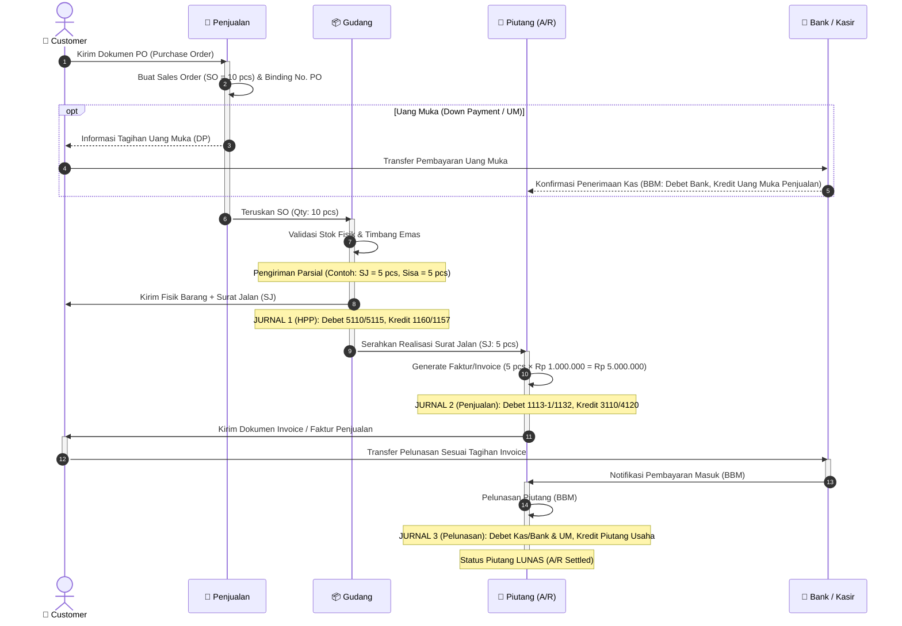

# Alur Proses Bisnis & Dokumen Penjualan (Sales Flow)

> **Dokumentasi Flowchart, Business Process & Pemetaan Jurnal COA (SAK EMKM)**  
> Ditranskripsikan dari sketsa operasional whiteboard: alur multi-divisi dari penerimaan pesanan pelanggan (*Customer PO*), pemrosesan *Sales Order (SO)*, pengeluaran parsial gudang (*Surat Jalan/SJ*), penagihan (*Invoice/Faktur*), hingga rekonsiliasi & pelunasan kas/bank (*A/R Settlement*).

---

## 1. Diagram Alur Swimlane (Mermaid Flowchart)

```mermaid
flowchart TD
    %% Definisi Swimlane / Subgraph Divisi
    subgraph LANE_CUST["1. CUSTOMER (Pelanggan)"]
        C_PO["Menerbitkan PO Customer<br/>(Purchase Order)"]
        C_DP["(Opsi) Bayar Uang Muka / DP"]
        C_RCV_SJ["Menerima Fisik Barang<br/>+ Surat Jalan (SJ)"]
        C_RCV_INV["Menerima Faktur / Invoice<br/>(Tagihan Penjualan)"]
        C_PAY["Melakukan Pembayaran / Transfer"]
    end

    subgraph LANE_SALES["2. PENJUALAN (Sales Dept)"]
        S_RCV_PO["Menerima PO Customer"]
        S_CREATE_SO["Membuat Sales Order (SO)<br/><i>Contoh: Qty = 10 pcs</i>"]
        S_PO_SO_REL["Validasi & Binding:<br/>PO Customer ↔ SO Internal"]
        S_NOTIF_WH["Meneruskan SO ke Gudang"]
    end

    subgraph LANE_WH["3. GUDANG (Warehouse & Logistics)"]
        W_RCV_SO["Menerima Instruksi SO (Qty: 10)"]
        W_CHECK_STOCK["Cek Fisik & Stok Vault"]
        W_CREATE_SJ["Menerbitkan Surat Jalan (SJ)<br/><i>Contoh Parsial: Kirim 5 pcs</i>"]
        W_TRACK_PARTIAL{"Status Pengiriman?"}
        W_PARTIAL["Status: PARTIAL (PER)<br/>Terkirim: 5 pcs<br/>Sisa SO: 5 pcs"]
        W_SHIP["Kirim Fisik Barang + SJ ke Customer"]
        W_NOTIF_AR["Input / Oper Data SJ ke Piutang"]
    end

    subgraph LANE_AR["4. PIUTANG (A/R & Invoicing)"]
        AR_RCV_SJ["Menerima Data Realisasi SJ (5 pcs)"]
        AR_CREATE_INV["Menerbitkan Faktur / Invoice<br/><i>5 pcs × Rp 1.000.000 = Rp 5.000.000</i>"]
        AR_SEND_INV["Kirim Faktur / Invoice ke Customer"]
        AR_MATCH["Rekonsiliasi Piutang (A/R)<br/>Potong Uang Muka (UM) jika ada"]
    end

    subgraph LANE_BANK["5. BANK & KASIR (Settlement)"]
        B_RCV_DP["Terima Uang Muka (DP / UM)"]
        B_RCV_PAY["Terima Pelunasan Invoice di Rekening Bank"]
        B_SETTLE["Pelunasan Piutang Usaha<br/>(Bukti Bank Masuk / BBM)"]
    end

    %% Hubungan dan Alur Antar-Divisi
    C_PO -->|1. Kirim PO| S_RCV_PO
    S_RCV_PO --> S_CREATE_SO
    S_CREATE_SO --> S_PO_SO_REL
    
    %% Alur Uang Muka (Bila ada DP)
    S_PO_SO_REL -.->|Jika ada syarat DP| C_DP
    C_DP -.->|Transfer DP| B_RCV_DP
    B_RCV_DP -.->|Catat Uang Muka (UM)| AR_MATCH

    %% Alur Gudang
    S_PO_SO_REL -->|2. Rilis SO| S_NOTIF_WH
    S_NOTIF_WH --> W_RCV_SO
    W_RCV_SO --> W_CHECK_STOCK
    W_CHECK_STOCK --> W_CREATE_SJ
    W_CREATE_SJ --> W_TRACK_PARTIAL

    W_TRACK_PARTIAL -->|Pengiriman Sebagian| W_PARTIAL
    W_PARTIAL --> W_SHIP
    W_SHIP -->|3. Fisik + Dokumen SJ| C_RCV_SJ
    W_PARTIAL -->|4. Salinan / Notif SJ| W_NOTIF_AR
    W_NOTIF_AR --> AR_RCV_SJ

    %% Alur Invoicing & Piutang
    AR_RCV_SJ --> AR_CREATE_INV
    AR_CREATE_INV --> AR_SEND_INV
    AR_SEND_INV -->|5. Tagihan Resmi| C_RCV_INV

    %% Alur Pembayaran & Pelunasan
    C_RCV_INV --> C_PAY
    C_PAY -->|6. Transfer Pelunasan| B_RCV_PAY
    B_RCV_PAY --> B_SETTLE
    B_SETTLE --> AR_MATCH

    %% Styling Theme
    classDef custClass fill:#1e293b,stroke:#94a3b8,color:#f8fafc,stroke-width:1.5px;
    classDef salesClass fill:#1e3a5f,stroke:#38bdf8,color:#f8fafc,stroke-width:1.5px;
    classDef whClass fill:#3b2d14,stroke:#f59e0b,color:#f8fafc,stroke-width:1.5px;
    classDef arClass fill:#3f1d2e,stroke:#f43f5e,color:#f8fafc,stroke-width:1.5px;
    classDef bankClass fill:#14342a,stroke:#10b981,color:#f8fafc,stroke-width:1.5px;

    class C_PO,C_DP,C_RCV_SJ,C_RCV_INV,C_PAY custClass;
    class S_RCV_PO,S_CREATE_SO,S_PO_SO_REL,S_NOTIF_WH salesClass;
    class W_RCV_SO,W_CHECK_STOCK,W_CREATE_SJ,W_TRACK_PARTIAL,W_PARTIAL,W_SHIP,W_NOTIF_AR whClass;
    class AR_RCV_SJ,AR_CREATE_INV,AR_SEND_INV,AR_MATCH arClass;
    class B_RCV_DP,B_RCV_PAY,B_SETTLE bankClass;
```

---

## 2. Sequence Diagram (Pertukaran Dokumen Antar-Fungsi)



---

## 3. Pemetaan Lengkap Debit & Credit Setiap Part di COA SAK EMKM

Berikut adalah aturan penjurnalan resmi per setiap part/tahapan transaksi sesuai dengan **Chart of Accounts (COA)** yang berlaku di ERP PT TAN (`data/storage.js` & `docs/blueprint/ACCOUNTING.md`):

### PART 1: Penerimaan PO & Pembuatan Sales Order (SO)
* **Dokumen Sumber**: Purchase Order (PO Customer) $\rightarrow$ Sales Order (`SO-xxxx`)
* **Status Finansial**: **TIDAK ADA JURNAL (Non-Posting Transaction)**
* **Penjelasan**: Tahap ini merupakan komitmen awal jual-beli dan order internal. Belum ada penyerahan fisik barang maupun hak klaim tagihan piutang, sehingga tidak ada mutasi debit/credit di buku besar.

---

### PART 2: Penerimaan Uang Muka / Down Payment (Bila Ada DP)
* **Dokumen Sumber**: Bukti Bank Masuk Uang Muka (BBM DP) / Kuitansi Uang Muka (`BBM-DP-xxxx`)
* **Pemicu**: Customer melakukan transfer DP sebelum barang dikirim.
* **Perlakuan Akuntansi**: Menambah saldo Kas/Bank dan mencatat Liabilitas (Kewajiban Uang Muka Penjualan).

#### 🟢 Skenario Penjualan Lokal (IDR):
| Posisi | Kode Akun | Nama Akun COA | Tipe | Penjelasan |
|---|---|---|---|---|
| **DEBET** | `1111-IDR` | **Bank BCA IDR (Operasional & Beli Lokal)** | Detail | Dana transfer DP masuk ke rekening bank |
| *(atau)* | `1110` | **Kas** | Detail | Jika diterima tunai di kasir |
| **KREDIT** | `2116-1` | **Uang Muka Penjualan Emas Lokal** | Detail | Kewajiban penyerahan barang di masa depan |

#### 🟢 Skenario Penjualan Ekspor (USD/SGD):
| Posisi | Kode Akun | Nama Akun COA | Tipe | Penjelasan |
|---|---|---|---|---|
| **DEBET** | `1111-USD` | **Bank BCA Devisa USD** | Detail | Dana valas DP masuk ke rekening devisa USD |
| *(atau)* | `1125` | **Bank Valas USD (Mandiri/BCA Ekspor)** | Detail | Rekening bank devisa penampung ekspor |
| **KREDIT** | `2116-2` | **Uang Muka Penjualan Perhiasan Ekspor** | Detail | Liabilitas uang muka ekspor |

---

### PART 3: Pengeluaran Barang dari Gudang (Surat Jalan / SJ)
* **Dokumen Sumber**: Surat Jalan / Delivery Order (`SJ-xxxx` / `DO-xxxx`), mendukung pengiriman parsial (*PER*).
* **Pemicu**: Fisik barang keluar dari brankas vault dan diserahkan kepada pihak ekspedisi/customer.
* **Perlakuan Akuntansi**: Pengakuan Harga Pokok Penjualan (HPP) dan pengurangan saldo fisik persediaan di vault.

#### 🟢 Skenario Penjualan Lokal (Logam Mulia / Emas Batangan):
| Posisi | Kode Akun | Nama Akun COA | Tipe | Penjelasan |
|---|---|---|---|---|
| **DEBET** | `5110` | **Harga Pokok Penjualan** (atau `41`) | Detail | Pengakuan beban pokok penjualan emas |
| **KREDIT** | `1157` | **Persediaan Emas Murni 999.9 (LM Lokal – Vault Utama)** | Detail | Pengurangan fisik emas di brankas vault |

#### 🟢 Skenario Penjualan Ekspor (Perhiasan Emas):
| Posisi | Kode Akun | Nama Akun COA | Tipe | Penjelasan |
|---|---|---|---|---|
| **DEBET** | `5115` | **Harga Pokok Penjualan Ekspor Perhiasan** | Detail | Pengakuan HPP perhiasan ekspor |
| **KREDIT** | `1160` | **Persediaan Perhiasan Emas Siap Ekspor (Vault Ekspor)** | Detail | Pengurangan fisik perhiasan jadi di vault ekspor |

---

### PART 4: Penagihan / Penerbitan Invoice (Faktur Penjualan)
* **Dokumen Sumber**: Invoice / Faktur Penjualan Komersial (`INV-xxxx`)
* **Pemicu**: Bagian Piutang (A/R) menerbitkan tagihan resmi sesuai kuantitas realisasi Surat Jalan (SJ) yang terkirim *(Billing based on Delivery)*.
* **Perlakuan Akuntansi**: Mengakui hak tagih (Piutang Usaha) dan mengakui Pendapatan Usaha (Penjualan).

#### 🟢 Skenario Penjualan Lokal (IDR):
| Posisi | Kode Akun | Nama Akun COA | Tipe | Penjelasan |
|---|---|---|---|---|
| **DEBET** | `1113-1` | **Piutang usaha Lokal** | Detail | Hak tagih atas penjualan lokal ke customer |
| **KREDIT** | `3110` | **Penjualan Lokal** (atau `3110-1`) | Detail | Pengakuan omset / pendapatan penjualan lokal |

#### 🟢 Skenario Penjualan Ekspor (Valas USD - PPN 0%):
| Posisi | Kode Akun | Nama Akun COA | Tipe | Penjelasan |
|---|---|---|---|---|
| **DEBET** | `1132` | **Piutang Usaha Ekspor USD** (atau `1113-2`) | Detail | Piutang valas USD ekspor |
| **KREDIT** | `4120` | **Pendapatan Ekspor Perhiasan Emas (PPN 0%)** (atau `3120`) | Detail | Pendapatan ekspor perhiasan emas |

---

### PART 5: Pelunasan & Rekonsiliasi Bank (A/R Settlement & BBM)
* **Dokumen Sumber**: Bukti Bank Masuk Pelunasan (`BBM-xxxx`)
* **Pemicu**: Customer melakukan pembayaran/transfer invoice ke rekening bank perusahaan.
* **Perlakuan Akuntansi**: Menambah kas/bank, menutup uang muka (bila ada DP), dan melunasi/menghapus saldo Piutang Usaha.

#### 🟢 Skenario A: Pelunasan Penuh (Tanpa DP):
*(Misal: Total Invoice Rp 5.000.000 dibayar lunas via transfer Bank BCA IDR)*

| Posisi | Kode Akun | Nama Akun COA | Tipe | Nominal |
|---|---|---|---|---|
| **DEBET** | `1111-IDR` | **Bank BCA IDR** | Detail | Rp 5.000.000 |
| **KREDIT** | `1113-1` | **Piutang usaha Lokal** | Detail | Rp 5.000.000 |

#### 🟢 Skenario B: Pelunasan dengan Pemotongan Uang Muka (Offsetting DP):
*(Misal: Total Invoice Rp 5.000.000, sebelumnya sudah ada DP Rp 1.500.000, sisa transfer Rp 3.500.000)*

| Posisi | Kode Akun | Nama Akun COA | Tipe | Nominal |
|---|---|---|---|---|
| **DEBET** | `1111-IDR` | **Bank BCA IDR** | Detail | Rp 3.500.000 (Sisa transfer) |
| **DEBET** | `2116-1` | **Uang Muka Penjualan Emas Lokal** | Detail | Rp 1.500.000 (Penyelesaian DP) |
| **KREDIT** | `1113-1` | **Piutang usaha Lokal** | Detail | Rp 5.000.000 (Pelunasan Piutang Penuh) |

---

## 4. Matriks Ringkasan Debit / Credit Semua Part

| No | Tahap / Dokumen | Pemicu Transaksi | Sisi DEBET (Akun COA) | Sisi KREDIT (Akun COA) |
|:---:|---|---|---|---|
| **1** | **PO $\rightarrow$ SO** | Input pesanan order | *(Tidak ada jurnal)* | *(Tidak ada jurnal)* |
| **2** | **Uang Muka (DP)** | Terima transfer DP | `1111-IDR` (Bank BCA IDR) / `1111-USD` | `2116-1` / `2116-2` (Uang Muka Penjualan) |
| **3** | **Surat Jalan (SJ)** | Pengeluaran fisik barang | `5110` / `5115` (Harga Pokok Penjualan) | `1157` / `1160` (Persediaan Barang Vault) |
| **4** | **Invoice / Faktur** | Penagihan resmi ke customer | `1113-1` / `1132` (Piutang Usaha) | `3110` / `4120` (Pendapatan Penjualan) |
| **5** | **Pelunasan (BBM)** | Pelunasan tagihan invoice | `1111-IDR` / `1111-USD` (Bank) + `2116-1` (UM) | `1113-1` / `1132` (Piutang Usaha) |

---

## 5. Aturan Integritas Akuntansi (Non-Negotiables)
1. **Hanya Akun `type: "detail"`**: Akun header seperti `1111` (Bank) atau `31` (Penjualan) dilarang didebet/dikredit langsung. Selalu gunakan rekening detail (`1111-IDR`, `1111-USD`, `3110`, `4120`).
2. **Keseimbangan Jurnal**: Total Debet wajib selalu sama dengan Total Kredit dalam satu ID transaksi jurnal.
3. **Pengakuan HPP vs Penjualan**: Pengakuan HPP terjadi pada saat terbitnya Surat Jalan (pengurangan fisik stok), sedangkan pengakuan Penjualan & Piutang terjadi pada saat penerbitan Faktur/Invoice.
