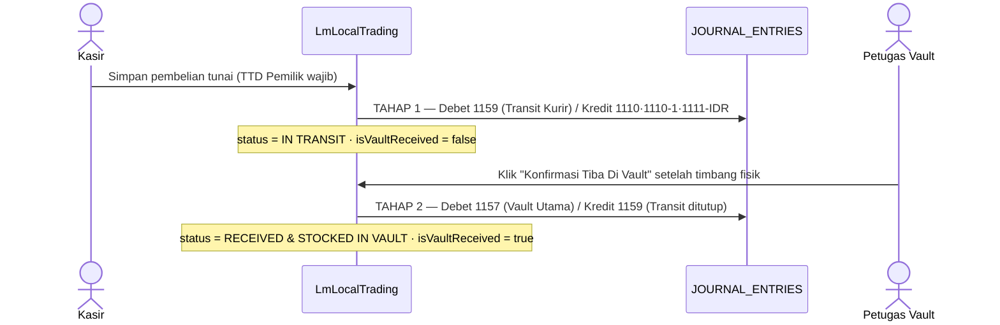

# Accounting

← [Blueprint INDEX](./INDEX.md)

PT TAN adalah pedagang & pengekspor logam mulia. Buku disusun menurut SAK EMKM. Setiap gram emas yang berpindah tempat wajib punya pasangan jurnalnya — itu satu-satunya alasan modul ini ada.

---

## Bentuk jurnal

Satu-satunya bentuk yang dipakai seluruh aplikasi, disimpan di `Storage.KEYS.JOURNAL_ENTRIES`:

```js
{
  id: Date.now(),
  entryNumber: 'JRN-PAY-123456',
  date: '2026-08-15',                    // YYYY-MM-DD, bukan ISO penuh
  description: '[TAHAP 1] Pembayaran Tunai Direct … | Debet: 1159 | Kredit: 1111-IDR',
  lines: [
    { accountCode: '1159', accountName: '…', debit: 4050000000, credit: 0 },
    { accountCode: '1111-IDR', accountName: '…', debit: 0, credit: 4050000000 }
  ],
  createdAt: new Date().toISOString()
}
```

Aturan yang tidak bisa ditawar:

1. `journals.unshift(entry)` — terbaru di depan. Konsisten di seluruh repo.
2. Total debit **harus** sama dengan total credit dalam satu entri.
3. Setiap baris memakai `accountCode` yang benar-benar ada di COA, dan `accountName` yang cocok dengan nama di COA.
4. `description` menyebutkan dokumen sumber (no. nota/PO/invoice) — itu jejak audit satu-satunya yang ada.
5. Jurnal ditulis di handler yang **sama** dengan yang menyimpan transaksinya, bukan di langkah terpisah yang bisa dilewati user.

---

## Alur 2 tahap: transit kurir → vault

Pembelian tunai emas di Pegadaian/Antam Jakarta melibatkan kurir yang membawa fisik emas. Antara uang keluar dan emas masuk brankas ada jeda berjam-jam sampai berhari-hari. Selama jeda itu emas **bukan** isi brankas.



| Tahap | Pemicu | Debet | Kredit |
|---|---|---|---|
| 1 | Transfer/bayar tunai | `1159` Persediaan Emas Dalam Perjalanan Kurir | sumber dana: `1110` Kas · `1110-1` Kas Kecil · `1111-IDR` Bank BCA IDR |
| 2 | Fisik tiba & ditimbang di brankas | `1157` Persediaan Emas Murni 999.9 (Vault Utama) | `1159` |

Saldo `1159` yang tidak nol di akhir hari berarti ada emas yang masih di jalan — itu memang gunanya. Melewatkan tahap 2, atau langsung mendebet `1157` saat bayar, menghapus kontrol itu.

Pembelian **kredit/tempo** tidak lewat transit: langsung Debet `1157`, Kredit akun utang. Lihat peringatan `2110` di bawah.

Implementasi: [src/pages/LmLocalTrading.jsx](../../src/pages/LmLocalTrading.jsx) — `handleSubmit()` (tahap 1) dan `handleConfirmVaultArrival()` (tahap 2).

---

## Peta akun yang sering dipakai

### Kas & bank

| Kode | Nama | Catatan |
|---|---|---|
| `1110` | Kas | detail |
| `1110-1` | Kas Kecil | detail |
| `1111` | Bank | **header — jangan dijurnal** |
| `1111-IDR` | Bank BCA IDR (Operasional & Beli Lokal) | pembelian lokal |
| `1111-USD` | Bank BCA Devisa USD | impor LBMA + terima ekspor |
| `1111-SGD` | Bank BCA Devisa SGD | impor bullion Singapura |

### Persediaan emas

| Kode | Nama |
|---|---|
| `1152` | Persediaan Scrap Retur Leburan |
| `1157` | Persediaan Emas Murni 999.9 (LM Lokal – Vault Utama) |
| `1158` | Persediaan Emas Murni 999.9 (LM Import – Vault Impor) |
| `1159` | Persediaan Emas Dalam Perjalanan Kurir (Transit) |
| `11502` | Persediaan Emas WIP (Vault Production WIP) |
| `1160` | Persediaan Perhiasan Emas Siap Ekspor (Vault Ekspor) |

### Pajak, piutang & uang muka

| Kode | Nama | Sifat |
|---|---|---|
| `1120-3` | PPh 22 (pajak dibayar di muka) | detail |
| `1135` | PPh 22 Dibayar Di Muka (Impor Emas) | detail |
| `1132` | Piutang Usaha Ekspor USD | detail |
| `1113-2` | Piutang Usaha Ekspor | detail |
| `1121` | Uang Muka Pembelian | **header** |
| `1121-1` | Uang Muka Pembelian Emas Lokal | detail |
| `1121-2` | Uang Muka Pembelian Emas Impor | detail |
| `1121-3` | Uang Muka Pembelian Operasional | detail |
| `2116` | Uang Muka Penjualan | **header** |
| `2116-1` | Uang Muka Penjualan Emas Lokal | detail |
| `2116-2` | Uang Muka Penjualan Perhiasan Ekspor | detail |

### Pendapatan & HPP

| Kode | Nama |
|---|---|
| `3110` / `3110-1` | Penjualan Lokal |
| `3120` / `3120-1` | Penjualan Export |
| `4210-1` / `4210-2` | HPP Penjualan Lokal / Export |
| `5114` | HPP Penjualan LM Lokal |
| `5115` | HPP Penjualan LM Import (Landed Cost) |
| `5118` | Biaya Susut Lebur Emas (Gold Loss) |
| `5150` | Biaya Freight & Insurance Impor / Ekspor |

Sumber kebenaran: `getDefaultChartOfAccounts()` di [data/storage.js:1658](../../data/storage.js) — 221 akun. Struktur puncaknya: `1` Aktiva · `2` Passiva · `3` Pendapatan · `4` Harga Pokok Penjualan · `5` Biaya Operasional · `6` Di luar usaha.

---

## Jebakan COA yang sudah terbukti

Verifikasi kode akun di COA **sebelum** memakainya. Empat kekeliruan berikut sudah ada di kode dan jangan direplikasi:

| Masalah | Kenyataan |
|---|---|
| `2110` "Hutang Usaha Supplier Lokal" | **Tidak ada di COA.** Yang ada `2111` Hutang Usaha dan `2111-1` Hutang Dagang. `LmLocalTrading` mode kredit mengkredit `2110` — utang masuk ke akun yang tidak terdaftar |
| `1111` sebagai akun pembayaran | `1111` adalah **header** "Bank". Yang boleh dijurnal `1111-IDR` / `-USD` / `-SGD`. Beberapa halaman masih memakai `1111` polos |
| `4110` sebagai pendapatan ekspor | `4110` di COA adalah **Direct Labour** (kelompok HPP). Master item memakainya sebagai `salesAccount`, dan `AccountingReports` melabelinya "Pendapatan Ekspor". Pendapatan yang benar `3120` |
| `4120` bernama "Pendapatan Ekspor Perhiasan Emas (PPN 0%)" | Duduk di kelompok `4` (HPP) dan anak-anaknya (`4120-1`…`4120-20`) adalah biaya pabrik. Nama akunnya salah slot |

Bila diminta merapikan ini, itu perubahan COA yang menyentuh laporan — konfirmasikan dulu ke user, jangan diam-diam.

---

## PPh 22 impor

PPh 22 Impor **tidak** dikapitalisasi ke landed cost. Ia pajak dibayar di muka yang dapat dikreditkan, bukan biaya perolehan. Saat penerimaan barang impor: Debet `1135` (atau `1120-3`), bukan menambah nilai `1158`.

`LmImportTrading` sudah menangkap nilainya di form dan meneruskannya ke payload PO (`pph22Import`) tanpa memasukkannya ke `totalLandedCostIDR` — itu perilaku yang benar. Yang belum ada: jurnal penerimaannya.

---

## Landed cost impor (model YLG Singapore)

Struktur harga lapangan yang dipakai PT TAN, diimplementasikan di [src/pages/LmImportTrading.jsx](../../src/pages/LmImportTrading.jsx):

```
Total Premium USD     = qty × premiumPerUnitUSD      // $2.00/oz — sudah termasuk kargo BRINKS
Total All-in Gold USD = baseAmountUSD + totalPremium // $1.300.000 + $32.000 = $1.332.000
Total Gold IDR        = allInUSD × exchangeRate
Total Landed Cost IDR = totalGoldIDR + beaMasuk + freightHandlingLokal
HPP per gram          = totalLandedCostIDR / totalWeightGrams
```

Ongkos kirim BRINKS dibayar YLG dan ditagihkan sebagai premium per ounce — jadi ia sudah masuk harga emas, **jangan ditambahkan lagi** sebagai freight terpisah.

Konversi satuan: `1 troy ounce = 31,1034768 gram`. Rumus ini terduplikasi di `LmImportTrading.jsx` dan `modules/purchaseOrder.js`. Bila mengubah salah satu, ubah keduanya, atau lebih baik satukan.

---

## Laporan

[src/pages/AccountingReports.jsx](../../src/pages/AccountingReports.jsx) punya 8 tab. Yang benar-benar dihitung dari `JOURNAL_ENTRIES`: Mutasi Jurnal dan Buku Besar. Laba Rugi, Neraca, dan Arus Kas masih **angka hardcoded di JSX**.

Modul `incomeStatement.js`, `balanceSheet.js`, dan `cashFlow.js` sudah dimuat `main.jsx` dan menempel di `window` — tiga tab statis itu tinggal disambungkan ke sana, bukan ditulis ulang.

### Dua bug saldo yang masih hidup

1. **Urutan salah.** `AccountingReports.jsx:63-76` mengakumulasi `runningBalance` atas `journals` apa adanya. Karena jurnal disimpan dengan `unshift`, akumulasinya berjalan dari transaksi terbaru ke terlama. Urutkan naik menurut `date` sebelum menghitung.
2. **Sisi normal belum dinormalisasi.** Saldo dihitung `debit - credit` untuk semua akun. Untuk kewajiban, ekuitas, dan pendapatan (kelompok `2` dan `3`), saldo tampil negatif.

---

## Checklist transaksi baru yang menyentuh buku

- [ ] Peristiwa akuntansinya jelas: kapan tepatnya kewajiban/aset berpindah?
- [ ] Kedua sisi jurnal memakai kode yang terverifikasi ada di COA sebagai `detail` (bukan `header`)
- [ ] Total debit = total credit
- [ ] Jurnal ditulis di handler yang sama dengan penyimpanan transaksinya
- [ ] Bila ada jeda fisik (kurir, kargo, produksi), pakai akun transit — jangan langsung ke akun tujuan
- [ ] Nomor dokumen dari `Storage.getNextReferenceNumber()`, bukan `Date.now()`
- [ ] Label tombol menjanjikan persis yang dilakukan kode — tanpa "Auto-Jurnal" yang tidak menjurnal
- [ ] Berat dalam gram, uang sebagai `Number`, tanggal `YYYY-MM-DD`

---

← [Blueprint INDEX](./INDEX.md)
