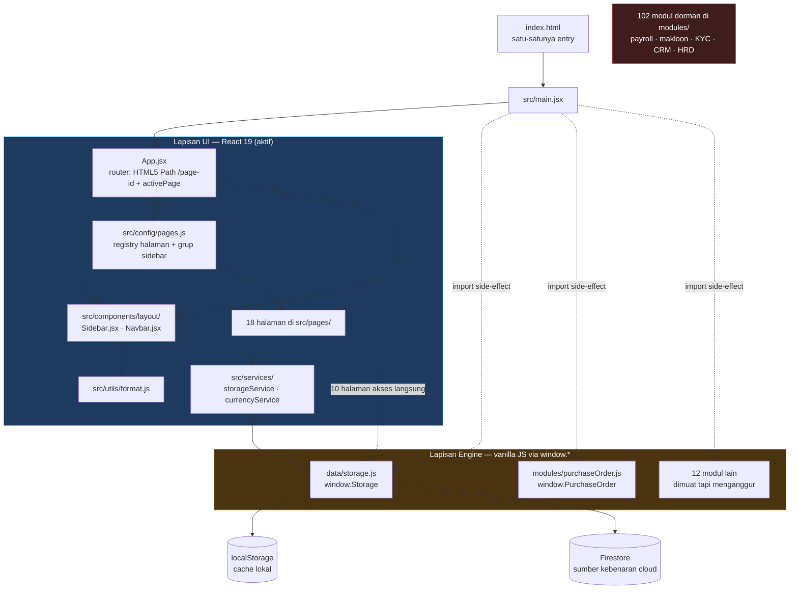

# Architecture

← [Blueprint INDEX](./INDEX.md)

---

## Dua aplikasi dalam satu repo

Repo ini menampung dua generasi aplikasi. Yang lama (vanilla JS, `app.js` + `modules/`) sudah berhenti jadi entry point; yang baru (React + Vite, `src/`) memakai potongan mesinnya lewat `window`.



**Konsekuensi yang harus selalu diingat:**

- `app.js`, `login.html`, dan `simulasi-awi.html` tidak pernah dieksekusi. Perbaikan di sana tidak terlihat user.
- Aplikasi React **tidak punya autentikasi**. `modules/auth.js` dimuat, tapi `App.jsx` tidak punya route guard.
- `firebase-config.js` meng-import Firebase dari CDN gstatic dan tidak di-import oleh `main.jsx`. Dalam app React, `window.db` biasanya kosong — artinya `CloudStorage` dan `CloudSequencer` diam-diam jatuh ke jalur localStorage. Lihat [STORAGE.md](./STORAGE.md).

---

## Boot sequence

[src/main.jsx](../../src/main.jsx) berjalan berurutan, dan urutannya penting:

```js
import './index.css';              // 1. styling global
import '../data/storage.js';       // 2. pasang window.Storage
import '../modules/auth.js';       // 3. …dan 13 modul legacy lain
// …
if (window.Storage) window.Storage.init();   // 4. seed default bila localStorage kosong
ReactDOM.createRoot(...).render(<App />);    // 5. baru React
```

`Storage.init()` mengisi COA default, master item, bank account, dan konfigurasi bila kunci-kuncinya belum ada. Halaman React yang membaca data di `useEffect` pertama sudah aman **karena** langkah 4 selesai sebelum langkah 5 — tapi guard `typeof window !== 'undefined' && window.Storage` tetap wajib, karena Jest merender komponen tanpa langkah 2–4.

Menambahkan modul legacy baru = menambah baris `import` di langkah 3. Tidak ada mekanisme lain; tidak ada lazy loading.

---

## Routing

Aplikasi menggunakan **Clean URL Path Routing** berbasis HTML5 History API standar (`window.location.pathname`, `pushState`, `popstate`) tanpa dependensi berat React Router. `App.jsx` mengelola state `activePage` yang tersinkronisasi dua arah dengan path URL:

```js
// URL format bersih per page: http://localhost:5173/import-trading
const getPageIdFromLocation = () => {
  const rawHash = window.location.hash.replace(/^#\/?/, '').trim();
  if (rawHash && getPage(rawHash)) return rawHash;

  const path = window.location.pathname.replace(/^\/+|\/+$/g, '').trim();
  if (!path || path === 'index.html') return DEFAULT_PAGE_ID;
  return getPage(path) ? path : DEFAULT_PAGE_ID;
};
```

- **Navigasi Bersih & Alami:** Setiap halaman memiliki URL murni (misal `/dashboard`, `/import-trading`, `/purchase-request`, `/goods-receipt`, `/accounting-reports`) tanpa karakter pagar (`#`).
- **Navigasi Klik / Tombol:** `setActivePage(pageId)` memperbarui URL melalui `window.history.pushState({}, '', '/' + pageId)` dan mengupdate state `activePage`.
- **Browser History & Bookmark:** Event listener `popstate` menangkap tombol Back / Forward browser dan memperbarui tampilan halaman secara instan.
- **Server SPA Rewrite:** Didukung penuh oleh Vite dev server dan Firebase Hosting rewrite (`**` → `/index.html` di `firebase.json`), sehingga direct access atau refresh (F5) pada URL `/import-trading` berjalan lancar.
- **Pembersihan URL Otomatis:** Sisa hash `#` lama (jika ada) otomatis dibersihkan saat boot.
- **Fallback Keamanan:** Jika URL path tidak dikenal, router otomatis fallback ke `DEFAULT_PAGE_ID` (`'dashboard'`).

---

## Aliran data

```
Halaman (useState form)
   → handler onSubmit
      → storageService.*()      ← tempat yang benar
      → window.Storage.set()    ← masih terjadi di 8 halaman
         → localStorage (sinkron)
         → CloudStorage.save()  (async, Firestore)
            → gagal? SyncGuard antre + banner merah
   → loadInitialData() dipanggil ulang → setState → re-render
```

Tidak ada cache, tidak ada query library, tidak ada invalidasi. Pola yang dipakai konsisten di seluruh halaman: setelah menulis, panggil ulang fungsi loader-nya sendiri.

**Lapisan service bocor.** Sepuluh halaman memanggil `window.Storage` langsung: `LmLocalTrading`, `GoodsReceiptPage`, `ExportInvoicing`, `ExportSalesOrderPage`, `ExportDeliveryOrderPage`, `AccountingReports`, `VoucherManagement`, `SystemSettingsPage`, `JewelryProduction`, `ChartOfAccounts`. Itu utang teknis yang sudah ada — jangan tambah, dan bila kebetulan menyentuh salah satunya untuk keperluan lain, pindahkan akses tersebut ke `storageService.js`.

---

## Integrasi eksternal

| Integrasi | File | Perilaku bila gagal |
|---|---|---|
| Kurs USD/IDR | [src/services/currencyService.js](../../src/services/currencyService.js) → `open.er-api.com` | Fallback ke nilai tersimpan di `localStorage['pttan_bca_erate_usd']`, lalu ke benchmark 16.250 |
| Firestore | [firebase-config.js](../../firebase-config.js) + `Storage.CloudStorage` | `window.db` kosong → sinkronisasi dilewati, aplikasi tetap jalan di localStorage |
| Firebase Auth | `modules/firebase-auth.js` | Tidak dipakai app React |
| PDF | `modules/pdfExporter.js` (422 KB) | Dimuat tapi tidak dipanggil; halaman React masih `alert()` sebagai placeholder cetak |
| WhatsApp | `modules/whatsappBot.js` | Dorman; dispatch WA di `LmLocalTrading` masih `alert()` |

Semua tombol "Cetak", "WA PDF", dan "Kirim" di halaman React saat ini adalah `alert()`. Itu placeholder yang disengaja — jangan diperlakukan sebagai fitur yang sudah jadi, dan jangan dihapus tanpa penggantinya.

---

## Build & deploy

```
npm run build     → vite build → dist/
firebase deploy   → predeploy menjalankan npm run build, lalu unggah dist/ + firestore.rules
```

[firebase.json](../../firebase.json) menambahkan SPA rewrite (`**` → `/index.html`), cache satu tahun untuk aset ber-hash, dan `no-store` untuk HTML. Security header (HSTS, X-Frame-Options DENY, nosniff) sudah terpasang di sana — bukan di kode aplikasi.

---

← [Blueprint INDEX](./INDEX.md)
