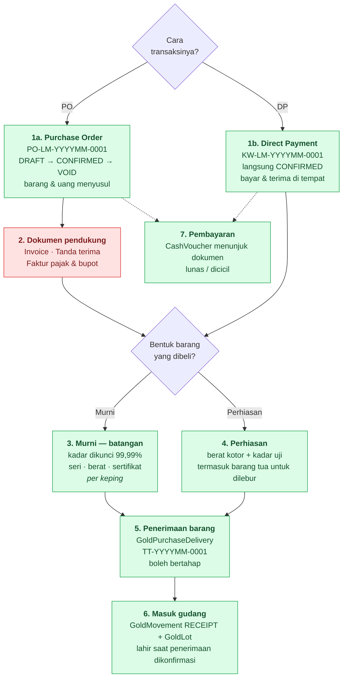

# Alur Pembelian Lokal

Pembelian emas dari mitra dalam negeri. Dua sumbu yang berdiri di atas satu rail: **cara transaksinya** (PO atau DP) dan **bentuk barangnya** (murni atau perhiasan).



Legenda: <span style="color:#16a34a">hijau</span> = sudah ada · <span style="color:#ca8a04">kuning</span> = ada sebagian · <span style="color:#dc2626">merah</span> = belum ada.

---

## 1. Dokumen pembuka — PO atau DP

**[SUDAH ADA]** — `GoldPurchase` dengan `type = LOCAL`, dua sumbu di atasnya:

| Sumbu | Nilai | Efeknya |
|---|---|---|
| `paymentType` | `PO` / `DP` | prefiks nomor (`PO-LM-` vs `KW-LM-`), dan kapan barangnya dianggap datang |
| `goodsType` | `BULLION` / `JEWELRY` | kadar dikunci atau diketik, dan lot berbentuk apa saat masuk gudang |

**PO** berhenti sebagai draft: barang dan uangnya menyusul, masing-masing dengan progresnya sendiri. **DP** selesai saat dibuat — dokumennya langsung `CONFIRMED` dan penerimaan penuhnya lahir dalam transaksi yang sama, karena kwitansi yang tercatat tanpa emasnya pernah masuk brankas adalah kebohongan yang tidak terlihat di layar mana pun.

Nomor dokumen selalu milik kita dan tidak pernah diketik; yang berubah hanya prefiksnya. Halamannya `/admin/purchases/local`, terpisah dari `/admin/purchases/import`.

---

## 2. Dokumen pendukung

Setelah PO, mitra menyerahkan berkas. Empat jenis, tidak semuanya selalu ada:

| Dokumen | Frekuensi | Isi pokok |
|---|---|---|
| Invoice | selalu | Tagihan dari mitra — nomor & tanggal invoice, nilai |
| Tanda terima | selalu | Bukti barang berpindah tangan |
| Faktur pajak & bukti potong (bupot) | selalu | Nomor faktur pajak, PPN; bupot untuk PPh yang dipotong |
| Kwitansi | pada DP | Dokumen DP itu sendiri berperan sebagai kwitansi |

**[BELUM ADA]** — belum ada tempat menyimpan berkas ini. Dua hal yang perlu diputuskan sebelum dibangun:

- **[BELUM DIPUTUSKAN]** Apakah keempatnya jadi satu blok field di dokumen (nomor + tanggal + lampiran per jenis), atau dokumen tersendiri yang menunjuk pembeliannya? Satu PO bisa dapat lebih dari satu invoice kalau pengirimannya bertahap — kalau itu terjadi, blok field tidak cukup.
- **[BELUM DIPUTUSKAN]** Perlu upload lampiran (scan/PDF) atau cukup nomor dokumennya saja?

Yang sudah pasti mengikat: nilai pajak yang dipakai jurnal **wajib disimpan di dokumennya**, bukan dihitung ulang dari tarif berlaku hari ini — sama seperti kurs disimpan di baris PO.

Tiga dokumen cetak yang diminta — **nota pembelian (PDF)**, **surat pernyataan**, dan **dokumen otoritas resmi kurir** — sudah punya tempatnya di halaman detail sebagai tombol nonaktif bertanda "Segera hadir". Tombolnya sengaja ada dan bukan disembunyikan: petugas yang mencarinya perlu tahu tempatnya memang di situ dan bahwa yang kurang adalah fiturnya, bukan izinnya.

---

## 3. Kalau barangnya murni — batangan

Kadarnya tidak dinegosiasikan: **99,99%**, dikunci dan tidak ditanyakan di form. Membiarkannya diketik cuma membuka jalan bagi 99,9% yang salah harga tanpa ada apa pun di layar terlihat keliru.

Berat murni jadi turunan penuh: `berat × 99,99% `, dan harga selalu **per gram emas murni**.

**Kapan seri batangan diisi** — inilah yang dijawab sumbu `paymentType`:

- **DP** — barangnya sudah di tangan saat kwitansi ditulis, jadi tiap keping dicatat di form: nomor seri, **beratnya sendiri**, nomor sertifikat, refiner.
- **PO** — saat memesan, keping mana yang akan dikirim memang belum ada. Serinya masuk lewat **penerimaan barang** di halaman detail, waktu barangnya datang.

Berat per keping punya barisnya sendiri (`GoldPurchaseDeliveryItem`) — bukan sekadar daftar nomor. Versi lama membagi berat dokumen rata ke jumlah seri: itu benar selama kepingnya seragam dan diam-diam salah begitu 250 g + 100 g + 50 g datang bersama. Konsekuensi yang ditegakkan saat simpan: **berat penerimaan = Σ berat batang**.

---

## 4. Kalau barangnya perhiasan

Perhiasan mencakup **barang tua atau rusak yang dibeli untuk dilebur** — dulu rail `SCRAP` tersendiri, sekarang tidak lagi: bentuknya sama persis (berat kotor ditimbang, kadarnya diuji, harganya deal-dealan per gram murni), jadi nilai enum tersendiri hanya menduakan satu hal yang sama.

Yang diketik: **berat kotor**, **kadar hasil uji**, dan **harga per gram murni**. Berat murni dan totalnya turunan.

```
berat murni = berat kotor × kadar / 100
total       = harga per gram murni × berat murni
```

Satu rumus, tanpa cabang — perhiasan berkadar 70% dan batangan 99,99% dihargai dengan dasar yang sama, jadi kolom harga tidak pernah perlu dibaca bersama kolom lain untuk tahu artinya.

Perhiasan masuk gudang sebagai satu lot berbentuk `SCRAP` ("barang masuk yang belum dipilah") di Ruang Sortir: barangnya memang belum tentu selesai dipilah di hari terima, dan memaksa hasil pilahannya diisi sekarang cuma melahirkan angka karangan.

- **[BELUM DIPUTUSKAN]** Pencatatan **per produk** (cincin sekian gram kadar sekian, gelang sekian gram kadar sekian) dengan kadar rata-rata tertimbang sebagai turunannya belum dibangun. Hari ini dokumen menyimpan satu berat dan satu kadar. Kalau nanti dibutuhkan, bentuknya `GoldPurchaseItem` dengan kadar dokumen dihitung `Σ(beratᵢ × kadarᵢ) / Σ beratᵢ` — rata-rata aritmetik biasa salah begitu beratnya tidak sama (1 g 24K + 99 g 18K bukan 21K).

---

## 5. Penerimaan barang

**[SUDAH ADA]** — `GoldPurchaseDelivery` + `GoldPurchaseDeliveryItem`, nomor `TT-202608-0001`, siklus DRAFT → CONFIRMED → VOID.

Penerimaan adalah **lapis realisasi** di atas lapis komitmen, persis pemisahan order ↔ pengiriman di sisi penjualan. Barang lokal datang belakangan dan bisa bertahap, jadi "berapa yang belum sampai" tidak punya tempat hidup kalau pesanan dan penerimaan dimampatkan ke satu baris.

Barisnya lahir sebagai **draft**: yang menaruh emas di rak adalah konfirmasinya, bukan pencatatannya — orang yang menimbang dan orang yang menyatakan barangnya benar diterima tidak selalu sama.

Aturan yang ditegakkan server:

- dokumennya harus sudah `CONFIRMED` (draft belum jadi kesepakatan)
- batangan wajib merinci tiap keping, dan berat penerimaan = Σ berat kepingnya
- total yang diterima tidak boleh melewati yang dibeli
- nomor seri harus bebas lintas **seluruh stok**, bukan hanya dalam satu penerimaan

---

## 6. Masuk gudang

**[SUDAH ADA]** — konfirmasi **penerimaan** (bukan konfirmasi dokumen) melahirkan satu `GoldMovement` bertipe `RECEIPT` plus lot-lotnya, dalam satu transaksi. Batangan jadi satu lot `BAR` per keping dengan berat kepingnya sendiri dan kadar 99,99%; perhiasan jadi satu lot `SCRAP` di Ruang Sortir.

Penerimaan terkonfirmasi hanya bisa di-VOID selama seluruh lot hasilnya belum bergerak. Begitu emasnya sudah disortir, dilebur, atau dijual, koreksinya lewat `ADJUSTMENT` bersaksi — bukan dengan menghapus sejarah. Membatalkan dokumen pembeliannya ikut membatalkan semua penerimaannya, dengan gerbang yang sama.

---

## 7. Pembayaran

**[SUDAH ADA]** — pembayaran dicatat sebagai `CashVoucher` biasa yang menunjuk dokumennya (`referenceType = 'GOLD_PURCHASE'`), jadi tiap pembayaran sekaligus masuk buku besar lewat satu pintu yang sudah ada. Cicilan berarti beberapa voucher, dan itu bentuk yang sama.

Yang sudah dibayar adalah **Σ voucher POSTED** yang menunjuk dokumen itu (voucher arah `IN` menguranginya, jadi pengembalian dana terbaca benar) — bukan kolom "sudah dibayar" tersendiri yang harus dijaga tetap sama dengan kas.

- **[BELUM DIPUTUSKAN]** Voucher pembayaran belum bisa dibuat langsung dari halaman detail pembelian dengan nilai dan mitra terisi; sekarang dibuat dari modul Keuangan lalu ditautkan.

---

## Progres

Dua batang progres di daftar dan di halaman detail. Keduanya **tidak punya kolom** — diturunkan saat dibaca, sama seperti saldo akun dari `journal_lines` dan sisa stok dari `gold_movement_lines`:

| Progres | Diturunkan dari | Pembanding |
|---|---|---|
| Pengiriman | Σ berat penerimaan `CONFIRMED` | `GoldPurchase.weightGram` |
| Pembayaran | Σ nilai voucher `POSTED` | `GoldPurchase.totalIdr` |

Perbandingannya dilakukan pada **satuan bulat terkecil** (miligram, sen): menjumlahkan float membuat dokumen yang persis lunas terbaca kurang seperseratus sen dan tidak pernah menutup. Kelebihan dilaporkan di atas 100% dan tetap CLOSED — menutupnya di 100 akan menyembunyikan justru kasus yang perlu dilihat orang.
