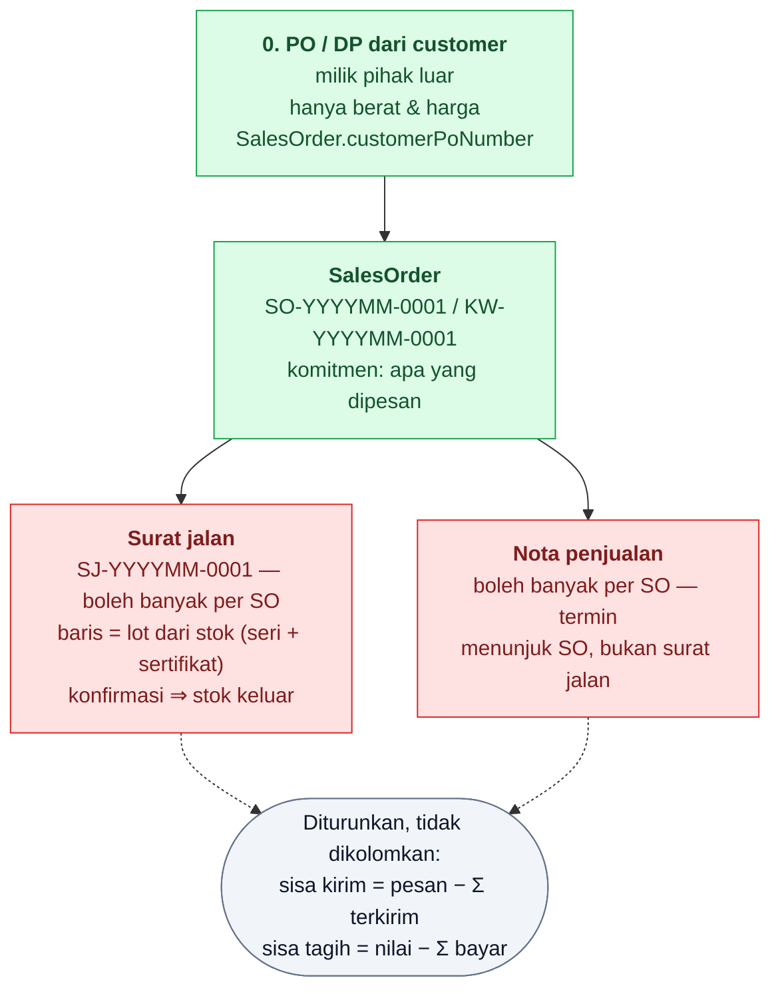

# Alur Penjualan

Penjualan ke customer, lokal maupun ekspor. Bentuknya **cermin dari pembelian**: satu dokumen komitmen (apa yang dipesan) di atas, lapis realisasi (apa yang benar-benar dikirim) di bawahnya, dan pembayaran berjalan sendiri — hanya arah barang dan uangnya yang terbalik.

Legenda: hijau = sudah ada · merah = belum ada.

Surat jalan dan nota **tidak berbaris** — keduanya menggantung langsung di SO dan berjalan sendiri-sendiri. Satu order bisa melahirkan banyak pengiriman dan banyak pembayaran, dan yang satu tidak menunggu yang lain.

---

## 0. PO / DP dari customer

Pembukanya dokumen milik **pihak luar** — customer mengirim pesanan ke kita. Isinya minimal: **berat** dan **harga**. Tidak lebih dari itu; sertifikat mana dan perhiasan mana yang akan dikirim belum dijawab di sini, dan draft memang boleh berhenti begitu saja.

**[SUDAH ADA]** — `SalesOrder` (`prisma/schema/sales.prisma`): `customerPoNumber` (nomor milik customer, teks bebas, sengaja tanpa unique) terpisah dari `number` kita yang selalu otomatis. Harga satuan ↔ total saling menurunkan di `onBlur`, dan berat selalu disimpan gram walau diketik dalam troy ounce.

**[DIPUTUSKAN 2026-08-13]** SO ikut memakai sumbu **PO/DP** yang baru masuk di pembelian: `PO` = dipesan dulu, barang dan uangnya menyusul; `DP` = dibayar dan diserahkan di tempat, jadi surat jalan penuhnya terbit sekaligus dengan dokumennya. Prefiks nomor mengikuti sumbunya, sama seperti `PO-LM-…` / `KW-LM-…` di pembelian.

Catatan yang sudah mengikat: **ekspor/lokal tidak disimpan di dokumen** — jawabannya negara mitra (`partnerOriginFromCountry`). Dan emas murni **hanya boleh lokal** — kombinasi `BULLION` + customer luar negeri ditolak `assertPartnerIsSalesCustomer()`.

---

## 1. Penjualan ekspor — modul tersendiri, cerminan pembelian import

~~**[DIPUTUSKAN 2026-08-13]** `ExportSale` dipensiunkan dan dilebur ke `SalesOrder`.~~

**[DIPUTUSKAN 2026-08-14]** Peleburan **dibatalkan**: developer memutuskan ekspor tetap jadi modulnya sendiri, tapi dibangun ulang mengikuti bentuk pembelian import **dengan posisi terbalik — kita sebagai supplier**. Alasannya bukan soal tabel, melainkan soal alur: ekspor punya PEB, biaya freight per kiriman, dan pembayaran valas yang tidak ada padanannya di penjualan lokal, dan memampatkan keduanya ke satu form berarti satu layar yang setengah fieldnya selalu tidak berlaku.

**[SUDAH ADA]** — `ExportSale` sekarang berlapis persis `MetalPurchase` IMPORT:

- **Dokumen** (`ExportSale` + `ExportSaleItem`) menyimpan kesepakatan: buyer, nomor PO buyer (teks bebas, milik mereka), mata uang, dan baris barang dengan berat, kadar, harga per gram. Tidak ada kolom berat maupun kurs di header — alasannya sama dengan PO LM.
- **Kiriman** (`ExportSaleDelivery` + baris + lot + biaya) menyimpan realisasinya: boleh banyak per dokumen, membawa **PEB dan AWB**-nya sendiri (satu dokumen yang dikirim dua kali punya dua PEB), kurir, dan biaya freight/asuransi/kepabeanan sebagai **baris rupiah** yang tidak mengurangi nilai barang.
- **Baris kiriman menunjuk `MetalLot` + lokasi**, tidak mengetik nomor: barang yang keluar sudah ada di gudang. Kadar disalin dari lotnya.
- Konfirmasi **kiriman** — bukan konfirmasi dokumen — yang menulis mutasi `ISSUE`, dan di sanalah PEB ditagih.
- Progres kirim & bayar diturunkan, tidak dikolomkan; uang masuk dibaca dari `CashVoucher` arah `IN` yang menunjuk dokumennya.

Ekspor logam mulia tetap terlarang: dokumen ekspor hanya menerima produk berbentuk perhiasan (`assertItemsAreExportable()`), kebalikan persis dari matriks import yang hanya menerima batangan.

---

## 2. Surat jalan

Bukti barang berpindah ke customer — lapis realisasi, kembaran `GoldPurchaseDelivery` di sisi pembelian.

**[BELUM ADA]** — bentuknya sudah ditetapkan:

- Boleh **banyak** per SO. Progres pemenuhan (OPEN/PARTIAL/CLOSED) **tidak dikolomkan** — diturunkan dari Σ berat surat jalan berstatus CONFIRMED, lewat `deliveryFulfillment()` yang sama dengan pembelian.
- **[DIPUTUSKAN 2026-08-13]** Barisnya **menunjuk lot yang ada di stok** (`GoldLot` dengan sisa > 0), bukan seri yang diketik bebas seperti baris penerimaan pembelian. Alasannya asimetris dengan sengaja: barang masuk memang belum ada di gudang saat dicatat, barang keluar **sudah** — mengetiknya bebas berarti membolehkan mengirim sertifikat yang tidak kita punya, dan tidak ada apa pun di layar yang akan menunjukkannya.
- Berat & kadar **aktual** dicatat di sini, bukan di order — angka di order adalah kesepakatan, hasil timbangan baru pasti saat barang keluar.
- Konfirmasi surat jalan menulis `GoldMovement` keluar dalam satu transaksi, persis `receiveGoldPurchase()` di arah sebaliknya. VOID hanya boleh selama mutasinya belum tersusul mutasi lain.
- PEB/AWB hidup di sini (lihat bagian 1).

---

## 3. Nota penjualan — termin

Pembayaran tidak sekaligus; customer mencicil. Tiap cicilan punya notanya sendiri.

**[DIPUTUSKAN 2026-08-13]** Nota menunjuk **order**, bukan surat jalan — termin adalah kesepakatan atas keseluruhan order, dan mengikatnya ke satu kiriman akan memaksa pembayaran dipecah mengikuti jadwal kirim yang tidak ada hubungannya. Ini menjawab permintaan "nota dikoneksikan dengan emas yang ada di PO ini": dari satu order bisa dibaca berapa gram yang sudah dibayar dan berapa yang belum.

**[BELUM ADA]** — generate-nya menyusul. Yang belum diputuskan:

- **[BELUM DIPUTUSKAN]** Termin dihitung dalam **rupiah** atau dalam **gram**? Kalau gram, sisa tagihan bergerak mengikuti harga emas dan nota harus menyimpan harga saat pelunasan; kalau rupiah, nilainya terkunci sejak order.
- **[BELUM DIPUTUSKAN]** Uang masuknya dicatat lewat `CashVoucher` (BKM/BBM) dengan nota sebagai referensinya — pola yang sudah dipakai pembayaran pembelian — atau nota sendiri yang menulis jurnalnya? Pintu jurnal tetap satu: `src/lib/journal.ts`.
- **[BELUM DIPUTUSKAN]** Faktur pajak keluaran (nomor + PPN) ikut di nota, atau dokumen sendiri?

Yang sudah pasti: sisa tagihan **tidak boleh jadi kolom** — diturunkan dari Σ pembayaran, sejalan dengan progres kirim dan saldo akun.

---

## 4. Penjualan perhiasan

Perhiasan boleh dijual lokal maupun ekspor (hanya `BULLION` yang terkunci lokal), dan alurnya sama: SO → surat jalan → nota. Yang **[BELUM DIPUTUSKAN]** tinggal bentuk barisnya:

- Dijual per **potong** (model, ukuran, jumlah) atau tetap per **berat total + kadar** seperti murni?
- Ada ongkos pembuatan / ongkos kerja terpisah dari harga emasnya?
- Batu permata dihargai terpisah? `GoldLot.stoneWeightGram` sudah ada, jadi beratnya memang dipisahkan di stok.

---

## Ringkasan status

| Langkah | Status |
|---|---|
| PO/DP customer → `SalesOrder` | **[SUDAH ADA]** — sumbu PO/DP menyusul |
| Penjualan ekspor (dokumen + baris + kiriman + biaya) | **[SUDAH ADA]** — modul tersendiri, cerminan import (2026-08-14) |
| Surat jalan (banyak per SO, baris = lot stok) | **[BELUM ADA]** — bentuknya sudah ditetapkan |
| Nota penjualan & termin (menunjuk SO) | **[BELUM ADA]** — dasar hitungannya **[BELUM DIPUTUSKAN]** |
| Baris perhiasan (per potong vs berat) | **[BELUM DIPUTUSKAN]** |
