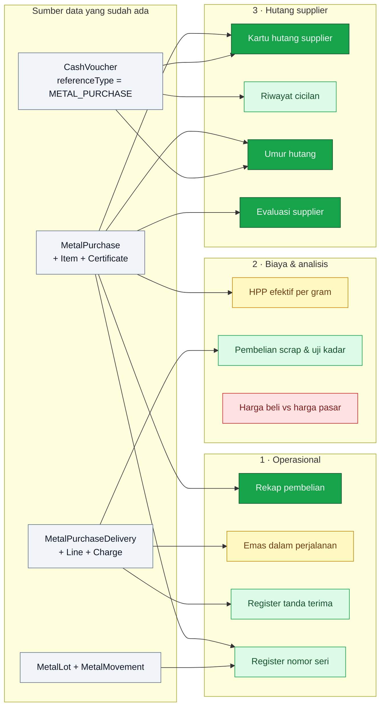

# Laporan Pembelian — Rail Lokal

Sepuluh laporan yang diminta manajemen, tim pengadaan, petugas vault, dan akuntansi, dipetakan ke data yang **benar-benar ada hari ini** di rail lokal (`MetalPurchase.type = LOCAL`). Rail impor menyusul; yang di sini hanya menyebut impor bila bentuk laporannya memang punya padanan lokal.

Penanda sama seperti alur lain: **[SUDAH ADA]** · **[BELUM ADA]** · **[BELUM DIPUTUSKAN]**.

> **Status 2026-08-14** — tiga laporan sudah dibangun dan hidup di menu **Laporan**: rekap pembelian (§1), hutang & umur hutang (§8 + §10), dan evaluasi supplier (§11). Satu kolom ditambahkan ke basis data untuk itu: `MetalPurchase.dueDate`, **opsional** — keputusan pemilik proses, karena mayoritas pembelian lokal adalah harga kesepakatan tanpa termin. Kadar XRF **tidak** dipisah dari kadar kesepakatan, alasan yang sama.



Legenda: **hijau pekat** = sudah jadi dan bisa dibuka · <span style="color:#16a34a">hijau muda</span> = datanya lengkap, tinggal dibangun · <span style="color:#ca8a04">kuning</span> = sebagian datanya ada, ada keputusan yang harus diambil · <span style="color:#dc2626">merah</span> = butuh data yang belum pernah dicatat di mana pun.

---

## 0. Di mana laporannya hidup

Permintaannya berbunyi "di dalam detail purchasing", tapi tujuh dari sebelas laporan ini **bertanya tentang periode, bukan tentang satu dokumen**: rekap bulanan, umur hutang, evaluasi supplier. Menaruhnya di halaman detail berarti tiap laporan cuma memuat satu baris.

Pembagiannya:

| Tempat | Isinya | Laporan |
|---|---|---|
| Tab di halaman detail dokumen | Yang jawabannya memang milik satu dokumen | Register nomor seri (§4, difilter dokumen), riwayat cicilan (§9) |
| Halaman laporan tersendiri (`/admin/reports/purchases/...`) | Yang jawabannya milik periode atau milik mitra | §1, §2, §3, §5, §6, §7, §8, §10, §11 |

Halaman laporan berdiri sebagai grup menu tersendiri di sidebar ("Laporan"), bukan anak dari Pembelian — laporan hutang dan evaluasi supplier dibaca akuntansi, bukan petugas pengadaan, dan izinnya pun berbeda.

**[SUDAH ADA]** — pembagian ini yang dipakai. Laporan periode hidup di `/admin/reports/purchases/…` dengan izinnya sendiri (`purchase-reports:register`, `:payables`, `:suppliers`), terpisah dari `metal-purchases:list`: petugas yang boleh membuat PO tidak dengan sendirinya boleh melihat nilai pembelian setahun beserta sisa hutangnya.

---

## Aturan bersama semua laporan

Empat hal ini berlaku di kesebelasnya, dan melanggarnya satu kali sudah cukup membuat angkanya tidak bisa dipakai:

1. **Baris, bukan dokumen.** Header pembelian sengaja tidak punya kolom berat maupun kadar: satu dokumen boleh memuat batangan emas bersama scrap. Setiap laporan yang menampilkan gram karena itu berdiri di `MetalPurchaseItem`, dan satu dokumen tampil sebagai beberapa baris.
2. **Gram tidak pernah dijumlah lintas logam.** Subtotal berat selalu dipecah per `Metal` (emas / perak). Yang boleh dijumlah bebas hanya uang, karena satu dokumen selalu satu mata uang.
3. **Hanya `CONFIRMED` yang masuk hitungan.** Draft belum terjadi dan VOID sudah tidak terjadi. Keduanya tetap bisa dilihat lewat filter status, tapi tidak pernah ikut subtotal — laporan yang subtotalnya berubah karena ada orang sedang mengetik draft tidak bisa dipakai menutup buku.
4. **Uang dibanding dalam sen, berat dalam miligram** (`src/lib/metal-purchase-progress.ts`). Kolom "sisa" yang berbunyi `0,0001` karena float adalah cara paling cepat membuat orang berhenti percaya pada laporannya.

Angka tampil lewat `formatNumber()` / `formatCurrency()`, tanpa pengecualian — termasuk di ekspor.

---

# 1 · Laporan operasional & penerimaan fisik

## 1. Rekapitulasi pembelian (Purchase Register)

**[SUDAH ADA]** — `/admin/reports/purchases/register`, dibaca dari `GET /api/reports/purchases/register`. Sumbernya `MetalPurchase` + `MetalPurchaseItem` + `Partner` + `Product`.

| Kolom diminta | Sumbernya |
|---|---|
| Tanggal | `MetalPurchase.date` |
| No. nota / PO | `number` (`PO-LM-…` / `KW-LM-…`) |
| Supplier | `partner.name` |
| Tipe (tunai/kredit/impor) | `paymentType` (PO/DP) + `type` (LOCAL/IMPORT) |
| Jenis emas | `item.product` — logam + bentuk, bukan enum tersendiri |
| Berat (gram) | `item.weightGram` dan `item.fineWeightGram`, **dua kolom** |
| Harga/g | `item.pricePerGram` + `item.priceBasis` |
| Total IDR | `item.amount`, subtotal `goodsAmount` |

Dua koreksi terhadap bentuk yang diminta. **"Tunai/kredit" bukan sumbu yang kita simpan** — yang kita simpan PO vs DP. DP praktis selalu tunai, tapi PO bisa lunas di hari yang sama; jadi "tunai/kredit" yang jujur adalah turunan progres pembayaran, bukan label yang diketik. Dan **kolom Harga/g tidak bisa dibaca sendirian**: batangan dihargai per gram kotor (`GROSS`), scrap per gram murni (`FINE`), jadi dasarnya ikut tampil di kolom yang sama.

**Yang diputuskan saat dibangun.** Biaya (`MetalPurchaseCharge` + `MetalPurchaseDeliveryCharge`) berdiri sebagai kartu ringkasan tersendiri dan tidak pernah masuk kolom nilai barang — konsisten dengan keputusan bahwa biaya adalah beban, bukan penambah nilai persediaan (§5). Ringkasannya dihitung atas **seluruh hasil filter**, bukan atas halaman yang tampil, dan filter statusnya berawal di `CONFIRMED`.

## 2. Emas dalam perjalanan (In-Transit)

**[BELUM ADA]** sebagai laporan, dan **[SEBAGIAN]** sebagai data.

Yang bisa dijawab hari ini: dokumen `CONFIRMED` yang barisnya belum tertutup — "sudah disepakati, belum sampai". Itu turunan murni dari `documentDeliveryFulfillment()`, tidak butuh kolom baru.

Yang **tidak** bisa dijawab, dan ini inti laporannya:

| Diminta | Keadaannya |
|---|---|
| Nama kurir | Ada, tapi di `MetalPurchaseDelivery` — dan penerimaan baru dibuat **saat barangnya sampai**. Emas yang masih di jalan belum punya baris di sana. `MetalPurchase.courierName` ada, tapi itu kurir yang dikuasakan atas dokumen impor, bukan pengantar kiriman ini |
| No. surat kuasa | `MetalPurchase.courierMandateNumber` — sama, satu per dokumen |
| Cabang Pegadaian | tidak ada di mana pun |
| Estimasi tiba | tidak ada di mana pun |
| Status vault | penerimaan menentukan lokasi sendiri (`src/lib/metal-receipt.ts`), tidak dipilih petugas |

- **[BELUM DIPUTUSKAN]** Dua jalan, dan pilihannya bukan soal selera:
  - **(a) Penerimaan dibuat lebih awal sebagai DRAFT** — petugas membuat TT saat kurir berangkat, isi kurir + ETA, lalu mengonfirmasinya saat barang ditimbang. Tidak ada model baru sama sekali; "dalam perjalanan" = penerimaan `DRAFT`. Konsekuensinya: draft penerimaan berhenti berarti "sedang diketik" dan mulai berarti "sedang di jalan".
  - **(b) Kolom baru di dokumen** (`expectedArrivalDate`, cabang asal) — lebih sempit, tapi hanya benar selama satu dokumen berarti satu kiriman; PO yang dikirim tiga kali langsung kehilangan dua ETA.

  Rekomendasi: **(a)**, dengan tambahan `expectedDate` di `MetalPurchaseDelivery` — kiriman adalah yang benar-benar berjalan, jadi ETA memang miliknya.

- **[BELUM ADA] Akun 1159 tidak punya pijakan akuntansi.** Pembelian dan penerimaan hari ini **tidak memposting jurnal sama sekali** — satu-satunya yang menyentuh buku besar adalah `CashVoucher`. Jadi "emas dalam perjalanan" bisa dilaporkan sebagai daftar operasional sekarang juga, tapi sebagai **saldo akun 1159** ia belum punya sumber. Itu pekerjaan tersendiri (jurnal otomatis pembelian: 1159 saat bayar-sebelum-terima, pindah ke 1157/1158 saat penerimaan dikonfirmasi) dan sebaiknya tidak diselundupkan ke dalam pekerjaan laporan.

## 3. Register tanda terima barang (GRN / TTB)

**[SUDAH ADA]** hampir seluruhnya — `MetalPurchaseDelivery`.

| Kolom diminta | Sumbernya |
|---|---|
| No. TTB | `number` (`TT-202608-0001`) |
| Ref PO | `purchase.number` |
| No. sertifikat assay | `MetalPurchaseItemCertificate.certificateNumber` per keping |
| Berat bersih masuk | `Σ line.fineWeightGram`, dipecah per logam |
| Penerima vault | `receivedByName` + `confirmedBy` |
| Kurir / resi / COR | `courierPartner`, `trackingNumber`, `corNumber` |

Satu yang belum ada: **no. surat jalan supplier**. `trackingNumber` adalah resi kurir — dokumen milik pihak lain yang berbeda, dan menumpangkannya di kolom yang sama akan membuat dua nomor berbeda arti tampil di satu kolom.

- **[BELUM DIPUTUSKAN]** Tambah `supplierDeliveryNoteNumber` di `MetalPurchaseDelivery` (teks bebas, tanpa unique — nomor milik orang lain), atau cukup dititipkan di `notes`?

Kolom yang layak ada tapi tidak diminta: **selisih kadar**. `MetalPurchaseDeliveryLine.purityPercent` boleh berbeda dari kadar barisnya (hasil uji ulang saat barang datang), dan selisih itu justru angka yang paling perlu dilihat orang.

## 4. Register nomor seri batangan (Bar Serial Register)

**[SUDAH ADA]** datanya, lengkap dari pesan sampai posisi sekarang.

Riwayat satu keping terbaca lurus: `MetalPurchaseItemCertificate` (dipesan) → `deliveryLineId` (datang di kiriman mana) → `lotId` → `MetalLot.serialNumber` (unik lintas seluruh stok) → `MetalMovementLine` (di mana dan tinggal berapa).

| Kolom diminta | Sumbernya |
|---|---|
| No. seri | `serialNumber` |
| No. sertifikat & refiner | `certificateNumber`, `refinerName` |
| Tanggal beli | `purchase.date` |
| Posisi stok | diagregasi dari `MetalMovementLine` `POSTED` (`src/lib/metal-stock.ts`) — **bukan kolom status di lot** |

Status keping punya tiga keadaan yang harus dibedakan, bukan dua: **dipesan tapi belum datang** (`deliveryLineId = null`), **di vault**, dan **sudah keluar** (terpakai produksi / terjual). Menggabungkan yang pertama ke "belum di vault" akan membuat keping yang memang belum pernah ada terbaca seolah hilang.

---

# 2 · Biaya & analisis pengadaan

## 5. HPP efektif per gram (padanan lokal dari Landed Cost)

**[SEBAGIAN]** — dan di sinilah ada tabrakan dengan keputusan yang sudah diambil, jadi perlu diputuskan sadar-sadar.

Biaya sudah tercatat rapi sebagai baris: `MetalPurchaseCharge` (menempel pada kesepakatan) dan `MetalPurchaseDeliveryCharge` (menempel pada satu kiriman). Tapi keduanya dinyatakan **beban tersendiri**: tidak menambah nilai barang, tidak masuk `goodsAmount`, tidak ikut progres pembayaran.

Laporan HPP efektif justru meminta yang sebaliknya:

```
HPP efektif / gram murni = (goodsAmount + Σ semua biaya) / Σ fine gram diterima
```

Keduanya bisa hidup bersama **asal jelas mana yang mana**: pembukuan tetap membebankan biaya sebagai beban (tidak ada perubahan model), sementara laporan ini menghitung HPP **sebagai analisis**, dengan kolom nilai barang dan kolom biaya berdiri terpisah sebelum kolom HPP-nya. Yang tidak boleh terjadi adalah angka HPP itu diam-diam dipakai sebagai nilai persediaan di jurnal.

- **[BELUM DIPUTUSKAN]** Cukup sebagai laporan analisis, atau biaya memang ingin dikapitalisasi ke nilai persediaan? Yang kedua bukan pekerjaan laporan — itu mengubah pemodelan dan menunggu jurnal pembelian ada dulu.
- **[BELUM DIPUTUSKAN]** Biaya yang menempel pada dokumen dibagi ke barisnya dengan bobot apa saat satu dokumen memuat emas dan perak — nilai baris (usulan), atau berat?

Untuk impor nanti laporan ini bertambah kolom FOB, kurs realisasi, bea masuk, dan PPh 22; kursnya sudah punya tempat yang benar (`CashVoucher.referenceExchangeRate`, kurs saat uangnya keluar), sementara PPh 22 belum punya tempat sama sekali.

## 6. Pembelian scrap & uji kadar

**[SUDAH ADA]** hampir seluruhnya, dengan satu lubang.

| Kolom diminta | Sumbernya |
|---|---|
| Toko penjual | `partner.name` |
| Berat kotor | `item.weightGram` |
| Kadar (%) | `item.purityPercent` |
| Berat emas murni | `item.fineWeightGram` |
| Harga per gram murni | `item.pricePerGram` (scrap selalu `priceBasis = FINE`) |

Lubangnya: **kadar hasil XRF dan kadar yang dipakai berharga adalah satu kolom yang sama.** Selama keduanya selalu sama, itu benar. Begitu ada tawar-menawar ("XRF 71,2%, dealnya 70%"), satu kolom tidak bisa menyatakan keduanya dan selisihnya — yang justru margin kita — tidak pernah bisa dilaporkan.

**[DIPUTUSKAN — tidak dipisah]** (2026-08-14). Kadar hasil alat dan kadar kesepakatan tetap **satu kolom**: di lapangan mayoritasnya harga kesepakatan, jadi kolom kedua akan kosong atau menyalin kolom pertama di hampir semua baris. Kalau tawar-menawar kadar kelak jadi kebiasaan, bentuknya sudah jelas — `assayPurityPercent` di samping `purityPercent`, pola dua-kadar yang sama dengan lot bal.

Baris scrap dikenali dari bentuk produknya, bukan dari sumbu dokumen — rail `SCRAP` tersendiri memang sudah dibuang.

## 7. Harga beli vs harga pasar (Market Benchmark)

**[BELUM ADA]** — dan ini satu-satunya laporan yang **datanya tidak ada sama sekali**. Tidak ada satu pun tabel yang menyimpan harga spot LBMA maupun harga Antam per tanggal.

Yang dibutuhkan minimal satu master baru:

```
MetalPriceQuote — tanggal · logam · sumber (LBMA/ANTAM/PEGADAIAN) · harga per gram · mata uang
```

Sekali per hari per sumber, dan **disimpan apa adanya per tanggal** — sama seperti kurs di voucher: harga pembanding yang dibaca ulang dari sumber hari ini akan diam-diam mengubah arti setiap laporan lama.

- **[BELUM DIPUTUSKAN]** Harganya diketik manual tiap hari oleh siapa, atau ditarik otomatis dari feed? Yang manual bisa dibangun minggu ini; yang otomatis butuh sumber berbayar dan penanganan hari libur bursa.
- **[BELUM DIPUTUSKAN]** Pembandingnya harga penutupan hari transaksi, atau harga pada jam deal? Kalau yang kedua, satu harga per hari tidak cukup.

Selama master itu belum ada, laporan ini tidak bisa dibangun sebagian — kolom "selisih" tanpa pembanding hanyalah kolom kosong.

---

# 3 · Keuangan & hutang supplier

## 8. Kartu hutang supplier (AP Sub-Ledger)

**[SUDAH ADA]** — `/admin/reports/purchases/payables`, satu layar bersama §10. Datanya `Σ CashVoucher` berstatus `POSTED` yang menunjuk `referenceType = 'METAL_PURCHASE'`, arah `IN` mengurangi (pengembalian dana terbaca benar). Tidak ada kolom "sudah dibayar" yang harus dijaga; itu keputusan lama yang justru membuat laporan ini mungkin.

| Kolom diminta | Sumbernya |
|---|---|
| Supplier | `partner` |
| No. PO / faktur | `number` + `supplierInvoiceNumber` |
| Nilai tagihan | `goodsAmount` |
| Total sudah dibayar | Σ voucher `POSTED` |
| Sisa saldo hutang | selisihnya, dibanding dalam sen |

Satu hal yang harus dinyatakan di mukanya: **biaya tidak ikut**, konsisten dengan progres pembayaran. Kalau ongkos kurir dibayar ke pihak ketiga, ia memang bukan hutang ke supplier itu; tapi kalau ditalangi supplier, ia hutang yang tidak akan pernah muncul di laporan ini.

- **[BELUM DIPUTUSKAN]** Biaya yang ditalangi supplier ditagihkan lewat dokumen pembelian yang sama, atau selalu lewat voucher tersendiri?

## 9. Riwayat cicilan (Installment Register)

**[SUDAH ADA]** seluruhnya — voucher yang menunjuk dokumen itu, diurutkan tanggal: no. voucher (`BKK-`/`BBK-`), tanggal, metode & bank, nominal, sisa berjalan setelah tiap cicilan.

Halaman `/admin/purchases/local/[id]/payments` sudah menampilkan daftarnya; yang kurang tinggal **kolom sisa berjalan** dan cetakannya.

Cek dan bilyet giro punya perilaku tersendiri yang harus terbaca di laporan ini: vouchernya mengkredit akun "cek/giro belum cair", bukan bank, dan pencairannya voucher kedua. Untuk supplier, tagihannya lunas saat voucher pertama diposting — tapi uangnya belum keluar, dan laporan yang tidak membedakan keduanya akan membuat orang mengira kasnya lebih kecil dari yang sebenarnya.

## 10. Umur hutang (AP Aging)

**[SUDAH ADA]** — ringkasan di atas tabel §8, dengan `MetalPurchase.dueDate` yang ditambahkan untuknya.

Empat keputusan yang mengikat, semuanya sudah berjalan:

**(1) `dueDate` diketik, bukan `paymentTermDays` yang diturunkan.** Keputusan pemilik proses: terminnya tidak selalu bilangan hari. Ia tetap **dibekukan di dokumen** — menghitungnya dari `Partner.purchaseTermDays` saat laporan dibaca akan membuat satu koreksi termin di master mengubah umur seluruh hutang lama, persis kesalahan yang dihindari dengan membekukan `priceBasis` di barisnya.

**(2) Opsional, dan tetap opsional.** Mayoritas pembelian lokal adalah harga kesepakatan yang dibayar di tempat; memaksanya terisi hanya melahirkan tanggal karangan yang kelak dilaporkan sebagai tunggakan. Dokumen DP tidak pernah membawanya sama sekali — uangnya keluar di hari kwitansinya.

**(3) Boleh diisi setelah dokumen dikonfirmasi**, lewat modal keterangan yang sama dengan nomor invoice (`PATCH …/reference`): terminnya sering baru diketahui bersama invoice supplier, dan invoice supplier justru datang belakangan. Tidak ada angka yang bergerak saat ia diisi — yang berubah hanya di ember mana dokumen ini duduk.

**(4) Lima ember, bukan tiga.** Selain 0–30 / 31–60 / >60 yang diminta, ada **belum jatuh tempo** (tagihan yang terbit kemarin tidak boleh duduk bersama yang lewat 29 hari) dan **tanpa jatuh tempo** yang berdiri sendiri dan tidak pernah dihitung terlambat. Umurnya dihitung dari tanggal jatuh tempo, bukan tanggal dokumen, dan tanggal acuannya bisa dimundurkan (`as_of`) — "umur pada 31 Agustus" selalu ditanyakan setelah tanggalnya lewat.

## 11. Evaluasi supplier (Vendor Evaluation)

**[SUDAH ADA]** — `/admin/reports/purchases/suppliers`. Agregasi per `partnerId` atas dokumen `CONFIRMED` dalam periode: frekuensi transaksi, total gram (**dipecah per logam**, tidak pernah dijumlah), total nilai.

Satu kolom tambahan sudah ikut dibangun: **harga rata-rata per gram murni**, satu-satunya cara membandingkan dua supplier yang menjual bentuk berbeda. Ia **berbobot nilai** (`Σ nilai / Σ gram murni`), bukan rata-rata kolom harga — rata-rata aritmetik memberi bobot yang sama kepada pembelian 1 g dan 1.000 g, sehingga satu transaksi kecil berharga aneh bisa menggeser angka yang dipakai menilai supplier.

Dua kolom lagi yang berguna dan belum dibangun, keduanya bisa diturunkan tanpa kolom baru:

- **ketepatan waktu kirim** — jeda `purchase.date` → `delivery.date` terkonfirmasi
- **selisih kadar terima vs kadar deal** — `deliveryLine.purityPercent` vs `item.purityPercent`; supplier yang barangnya selalu turun kadar saat ditimbang ulang adalah hal yang paling mahal dan paling tidak kelihatan

---

## Ringkasan perubahan model yang dibutuhkan

Tujuh dari sebelas laporan bisa dibangun **tanpa menyentuh skema sama sekali**. Yang butuh perubahan:

| # | Laporan | Yang dibutuhkan | Status |
|---|---|---|---|
| 10 | Umur hutang | `MetalPurchase.dueDate`, opsional | **sudah** — migrasi `20260814210000_purchase_due_date` |
| 6 | Scrap & uji kadar | `MetalPurchaseItem.assayPurityPercent` | **tidak jadi** — kadar tetap satu kolom |
| 2 | Emas dalam perjalanan | `MetalPurchaseDelivery.expectedDate` + konvensi "draft = di jalan" | belum |
| 2 | Saldo akun 1159 | Jurnal otomatis pembelian & penerimaan | belum — pekerjaan tersendiri |
| 3 | Register TTB | `MetalPurchaseDelivery.supplierDeliveryNoteNumber` | belum |
| 7 | Harga beli vs pasar | Master `MetalPriceQuote` + cara mengisinya | belum |

## Sisa pekerjaan

Diurutkan dari yang paling siap dikerjakan:

1. **Register TTB (§3) + register nomor seri (§4)** — datanya lengkap, kebutuhan vault, tidak menunggu keputusan apa pun.
2. **Riwayat cicilan (§9)** — daftarnya sudah tampil di tab Pembayaran; yang kurang kolom sisa berjalan dan cetakannya.
3. **Laporan scrap (§6)** — datanya lengkap sejak kadar diputuskan tetap satu kolom.
4. **HPP efektif (§5)** — setelah pembagian bobot biaya ke baris diputuskan.
5. **Emas dalam perjalanan (§2)** dan **harga pasar (§7)** paling akhir — keduanya menunggu keputusan, bukan menunggu kode.

## Pertanyaan yang masih terbuka

1. Semua laporan perlu ekspor? Excel, PDF, atau keduanya — dan adakah yang perlu kop surat resmi karena dikirim keluar?
2. Biaya dokumen dibagi ke barisnya dengan bobot apa saat satu dokumen memuat emas dan perak — nilai baris, atau berat? (§5)
3. Harga pasar diketik manual tiap hari oleh siapa, atau ditarik feed? (§7)
4. "Emas dalam perjalanan" dicatat sebagai penerimaan draft, atau kolom ETA di dokumen? (§2)
5. Perlu filter supplier di layar laporan? API-nya sudah menerima `partner_id`; yang belum ada tinggal pickernya.
