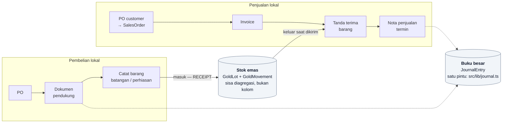
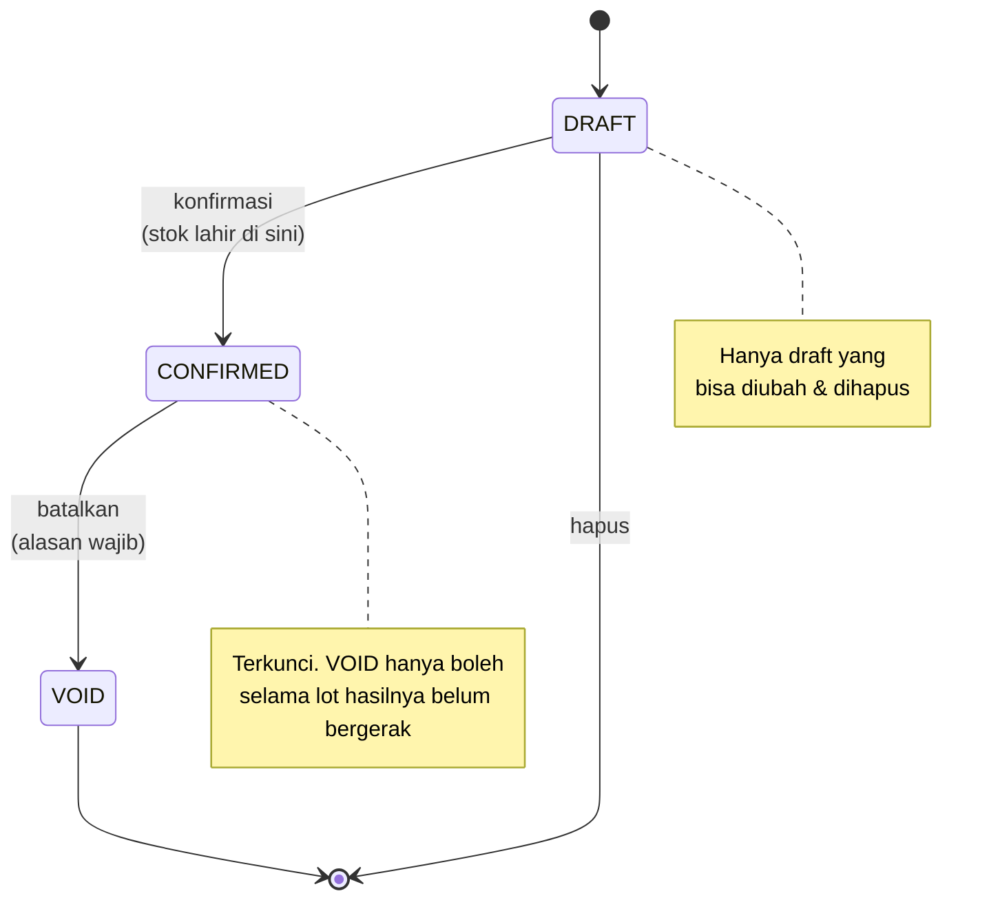

# Flow — Alur Proses Bisnis

Folder ini menampung **alur lapangan** PT TAN sebagaimana diceritakan developer: urutan dokumen, apa yang dicatat di tiap langkah, dan apa yang belum diputuskan. Isinya *bukan* spesifikasi implementasi — spesifikasi teknis tetap di `docs/blueprint/`, dan keputusan pemodelan yang sudah diambil tetap di `docs/knowledge/THIS.md`.

Gunanya satu: sebelum menulis modul, baca dulu alur yang dilayaninya, supaya bentuk dokumen di aplikasi mengikuti bentuk transaksinya di lapangan — bukan sebaliknya.

| Alur | File |
|---|---|
| Pembelian lokal (murni & perhiasan) | [01-pembelian-lokal.md](01-pembelian-lokal.md) |
| Penjualan lokal (murni & perhiasan) | [02-penjualan-lokal.md](02-penjualan-lokal.md) |
| Laporan pembelian lokal (11 laporan yang diminta) | [03-laporan-pembelian-lokal.md](03-laporan-pembelian-lokal.md) |

## Peta besar

Dua alur ini bertemu di satu titik saja — **stok emas**. Pembelian menambah lot, penjualan mengeluarkannya; tidak ada dokumen pembelian yang menunjuk dokumen penjualan secara langsung.

## Siklus dokumen

Semua dokumen transaksi memakai siklus yang sama — dan alasannya sama: dokumen terkonfirmasi **dikoreksi dengan dibatalkan, bukan diedit**, supaya sejarahnya tetap bisa dibaca.

Voucher kas/bank (`CashVoucher`) adalah pengecualian — siklusnya lima status karena butuh persetujuan: DRAFT → PENDING_APPROVAL → APPROVED → POSTED → VOID.

## Cara membaca

Tiap dokumen memakai tiga penanda:

- **[SUDAH ADA]** — sudah ter-implementasi, dengan penunjuk ke model/file-nya
- **[BELUM ADA]** — bagian alur yang belum punya dokumen di aplikasi
- **[BELUM DIPUTUSKAN]** — developer sendiri belum menetapkannya; jangan tebak, tanya dulu

Aturan yang sama seperti blueprint: kalau alurnya berubah di lapangan, dokumen ini yang diperbarui lebih dulu, baru kodenya.
